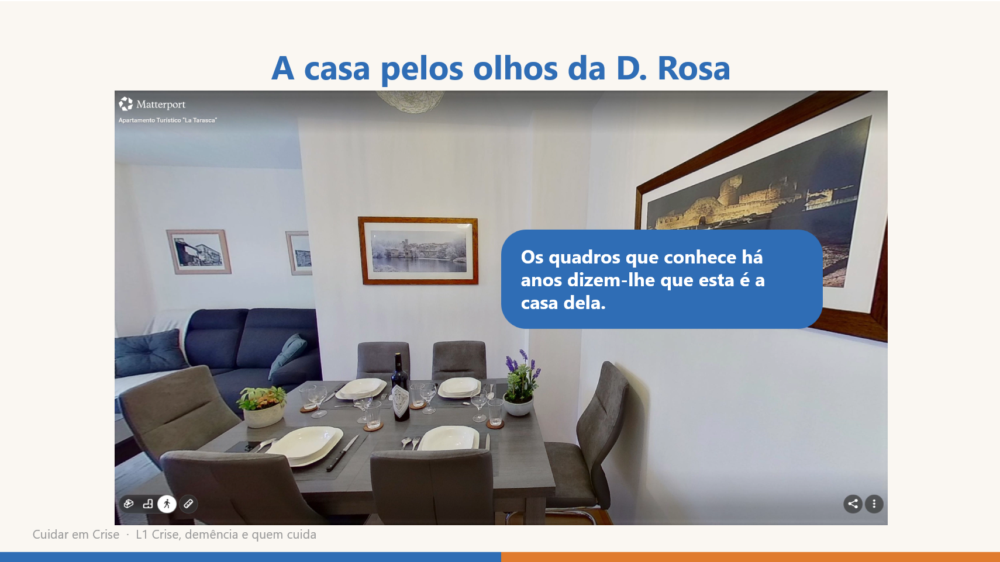
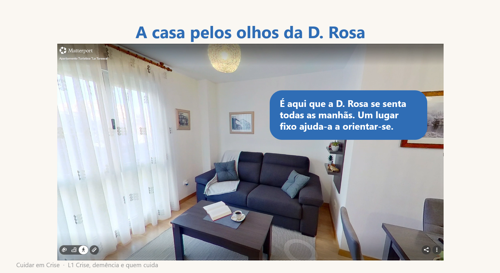
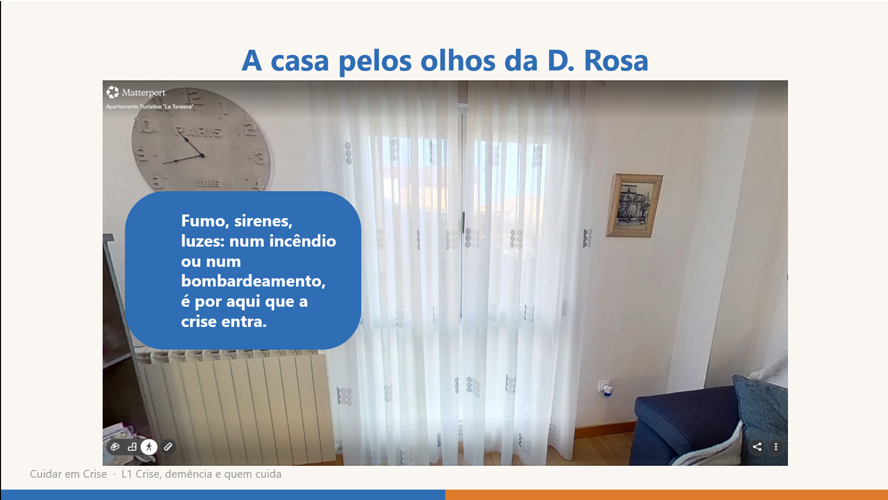
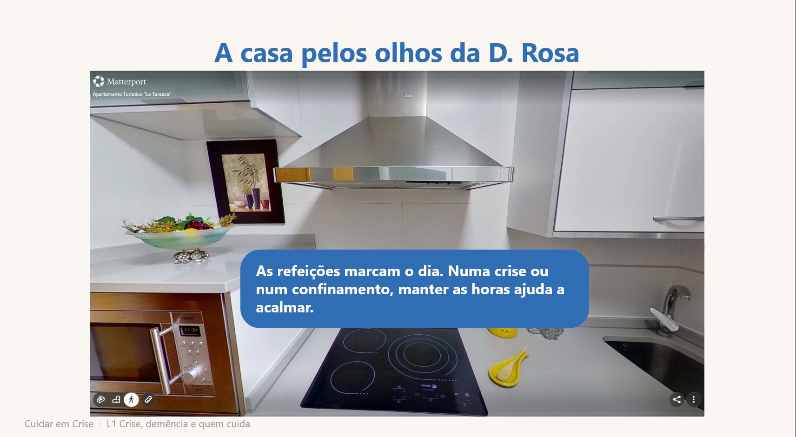
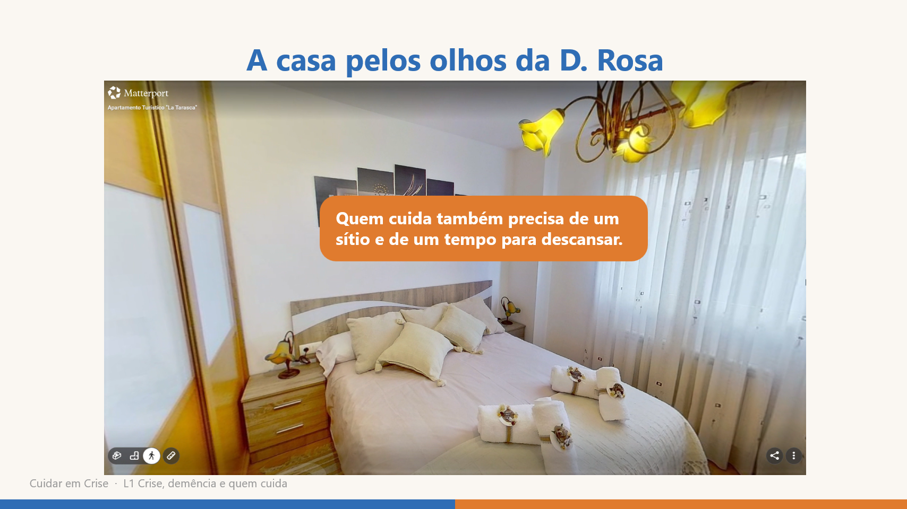
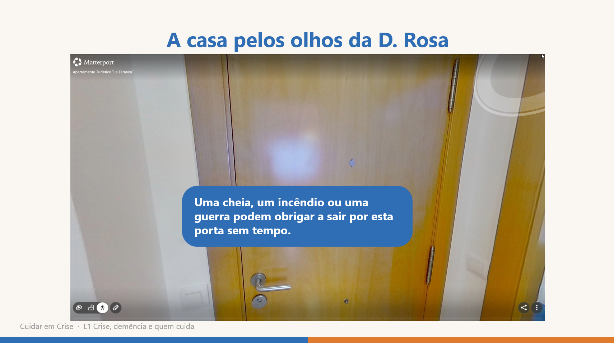

# Guião e storyboard da L1 «Crise, demência e quem cuida»

**Responsável:** Bruno Lopes (1240441) · **Versão:** 2 (26/10/2026) · Evidências 1, 2 e 5 do S4 (`S4_Plano_L1.md`, §4)

Decisões: o incêndio é **só o exemplo** do gancho (a lição vale para qualquer crise) · ilustração plana (azul = pessoa, laranja = cuidador) · tratamento por «você» implícito · cada um grava a sua voz, sem avatar (a voz e o uso de avatar têm de ser iguais nas 5 lições: se mudar, muda para todos).

---

## 1. Estrutura na Udemy (secção 1)

| Aula | Tipo | Duração | Diapositivos (`S4_Video_L1.pptx`) |
|---|---|---|---|
| Aula 1 · Crise, demência e quem cuida | Vídeo (gancho) | ≈ 1:05 | 1–4 |
| Aula 2 · A pessoa, quem cuida e os 3 passos | Vídeo (conteúdo) | ≈ 3:15 | 5–8 |
| Aula 3 · O que dá segurança? | Texto (reflexão) | 2 min | — |
| Teste 1 · Teste a compreensão | Quiz (4 perguntas) | 1,5 min | — |
| Aula 4 · Síntese e próxima lição | Vídeo | ≈ 0:25 | 9–10 |

Para exportar cada vídeo à parte (Aulas 1, 2 e 4): ocultar os outros diapositivos antes de «Exportar → Criar um vídeo».

---

## 2. Guião

Ritmo calmo ≈ 130 palavras/min. «[pausa]» = 1 s de silêncio.

| Cena | Diap. | Tempo | Narração (texto exato) | Imagem | Som |
|---|---|---|---|---|---|
| **1 · Casa calma** | 1–2 | 0:00–0:25 *(Aula 1)* | Esta é a D. Rosa. Vive com demência. Todas as manhãs senta-se no mesmo sofá, na sala. As refeições, sempre à mesma hora, marcam-lhe o dia. Os quadros que conhece há anos dizem-lhe que esta é a sua casa. [pausa] Esta é a Ana, a filha. É ela quem cuida da mãe, todos os dias. | Diap. 1: capa. Diap. 2: a D. Rosa (de bengala) e a Ana, que a ampara, na sala de casa, com as etiquetas «Ana» (laranja) e «D. Rosa» (azul). | Música calma, baixa (diap. 1–2). Relógio a fazer tique-taque, em ciclo, só no diap. 1. |
| **2 · Alerta** | 3 | 0:25–0:50 | Num fim de tarde de verão, chega um alerta: há um incêndio perto da aldeia e é preciso sair. [pausa] Uma crise muda tudo de um momento para o outro. Para uma pessoa com demência, muda ainda mais. E quem cuida tem de se manter de pé por dois. | Pessoa ao telemóvel, aflita, a receber um alerta (balão com «!»). Ao clicar, aparece a frase «Uma crise muda tudo de um momento para o outro.» | Corta a música. Só a sirene. |
| **Título** | 4 | 0:50–1:05 | O incêndio é só um exemplo. Uma cheia, uma pandemia ou ter de fugir de uma guerra fazem o mesmo: tiram a rotina e as referências de um dia para o outro. | Título «L1 · Crise, demência e quem cuida» + 4 ícones em círculos, um por clique: incêndio (chama), cheia (ondas), pandemia (vírus), deslocação (pessoa com mala). | Volta a música calma, desde o início. |
| **3a · A pessoa** | 5 | 0:00–0:45 *(Aula 2)* | Para a D. Rosa, a casa e a rotina são o que lhe dá segurança. Pode não saber em que dia está, mas sabe onde fica o seu sofá. Numa crise, isto desaparece: há ruído, luzes, pressa, caras desconhecidas, um sítio novo. A pessoa com demência pode não perceber o que se passa, nem porque tem de sair. É normal que fique mais confusa, com medo ou agitada, ou que se recuse a sair. Não é teimosia. É a doença a reagir a um mundo que, de repente, deixou de fazer sentido. | Ecrã dividido, metade azul em destaque: D. Rosa confusa, com a mão na cabeça. Palavras, uma por clique: desorientação · agitação · recusa. | Música calma, desde o início (diap. 5–8). |
| **Visita 3D** | 6 | 0:45–1:43 | *(sem narração: visita gravada no Matterport, «A casa pelos olhos da D. Rosa», com 6 etiquetas; roteiro no §3)* | Título «A casa pelos olhos da D. Rosa» + vídeo da visita (`L1_Visita3D.mp4`, 58 s, começa sozinho). As 6 etiquetas aparecem por cima, cada uma no seu segundo. | Música baixa (continua). |
| **3b · Quem cuida** | 7 | 1:43–2:23 | E a Ana? Também sente o choque: ansiedade, cansaço, irritação, dificuldade em pensar com clareza. São reações normais a uma situação que não é normal. Mas a Ana já vinha cansada. E numa crise perde, muitas vezes, a ajuda que tinha: o centro de dia, os vizinhos, a família. Nos planos de emergência, as pessoas com demência e quem cuida delas ficam muitas vezes esquecidas. Se a Ana não cuidar de si, não consegue cuidar da mãe. | Ecrã dividido, metade laranja em destaque: quem cuida, preocupado, sentado num cadeirão. Palavras, uma por clique: ansiedade · cansaço · irritação. | Música calma. |
| **4 · Os 3 passos** | 8 | 2:23–3:13 | Há uma forma simples de ajudar nestes momentos: os primeiros socorros psicológicos. Não são terapia e não é preciso ser profissional. São três passos. [pausa] Observar: ver se há perigo, do que a pessoa precisa e como está a reagir. E como está você. [pausa] Escutar: aproximar-se com calma, ouvir sem pressa, ajudar a acalmar. [pausa] Encaminhar: responder às necessidades básicas e saber a quem pedir ajuda. [pausa] Neste curso, vai aplicar estes três passos à pessoa de quem cuida, e a si. | Infografia em 3 cartões, um por clique: Observar (olho) → Escutar (orelha) → Encaminhar (placa de direções). | Música calma. |
| **5 · Síntese** | 9 | 0:00–0:12 *(Aula 4)* | Numa crise, a pessoa com demência perde as suas referências, e quem cuida fica sob pressão. Observar, escutar e encaminhar ajuda os dois. | Síntese em 2 linhas (azul e laranja) + os 3 passos. | Música calma, desde o início (diap. 9–10). |
| **Ponte** | 10 | 0:12–0:25 | Mas há muito que pode fazer antes de a crise chegar. É isso que vamos ver na próxima lição: preparar antes. | Mapa das 5 lições com a L2 em destaque. Créditos em baixo: Storyset e música. | A música vai baixando até acabar. |

**Música:** «High Class», Benjamin Andrews (Biblioteca de Áudio do YouTube), volume baixo. Entra nos diap. 1, 4, 5 e 9 e recomeça sempre do início: o diap. 3 corta-a, e cada vídeo (Aulas 1, 2 e 4) exporta-se à parte. **Ilustrações:** Storyset, estilo Amico.

**Narração:** ≈ 420 palavras → Aula 1 ≈ 1:05 + Aula 2 ≈ 3:15 (incluindo 58 s de visita 3D); Aula 4 ≈ 25 s. Com a atividade (2 min) e o quiz (1,5 min), a lição tem ≈ 8 min. Se a voz sair mais rápida, alongar a visita 3D, não a narração.

**Fontes:** OMS (2011) *Psychological First Aid* — os 3 passos (*look, listen, link*) · ADI (2019) *Forgotten in a Crisis* — pessoas com demência esquecidas nos planos de emergência · ADI (2022) *Advice for carers… during times of crisis* — reações do cuidador e perda de apoio.

---

## 3. Matterport · «A casa pelos olhos da D. Rosa»

**Plano B (S5):** um espaço público do Matterport Discover, apresentado como a casa da D. Rosa. A casa capturada pelo grupo decide-se no S6. A Udemy não aceita iframes, por isso a visita entra de duas formas:
- **vídeo gravado** (58 s) no **diap. 6** do `S4_Video_L1.pptx`, dentro da Aula 2;
- **link «Visita 3D»** como recurso da Aula 3 (opcional, nunca preciso para o quiz).

| Espaço Discover | Link | Autor |
|---|---|---|
| Apartamento Turístico «La Tarasca» (C. San Basilio 7, Zamora, Espanha; Ricoh Theta Z1) | https://discover.matterport.com/space/R1sZEUzLrz9 | IInmobarrios |

Critérios do espaço: entrada, sala com janela, cozinha e quarto; mobília comum, não de luxo; de preferência em Portugal.

### Roteiro (diap. 6, Aula 2, 0:45–1:43)

Sem narração: a voz pára e só fica a música baixa. Ordem da visita: sala (quadros, sofá, janela) → cozinha → quarto → porta. Tempos contados desde o início do vídeo (58 s).

| Tempo | Paragem | Etiqueta (texto no ecrã) | Cor | Crise ligada |
|---|---|---|---|---|
| 0:00–0:10 | Início da visita | — | — | — |
| 0:10–0:13 | Sala · quadros | Os quadros que conhece há anos dizem-lhe que esta é a casa dela. | azul | — (referências) |
| 0:17–0:22 | Sala · sofá | É aqui que a D. Rosa se senta todas as manhãs. Um lugar fixo ajuda-a a orientar-se. | azul | — (rotina) |
| 0:23–0:27 | Sala · janela | Fumo, sirenes, luzes: num incêndio ou num bombardeamento, é por aqui que a crise entra. | azul | Incêndio, conflito armado |
| 0:34–0:38 | Cozinha · banca | As refeições marcam o dia. Numa crise ou num confinamento, manter as horas ajuda a acalmar. | azul | Pandemia |
| 0:46–0:50 | Quarto | Quem cuida também precisa de um sítio e de um tempo para descansar. | laranja | — (quem cuida) |
| 0:56–0:58 | Entrada · porta | Uma cheia, um incêndio ou uma guerra podem obrigar a sair por esta porta sem tempo. | azul | Cheia, incêndio, deslocação forçada |

O espaço não tem fotografias nem relógio na cozinha: as fotografias passaram a **quadros** e o relógio passou à **banca da cozinha** (a rotina das refeições). As etiquetas da janela, da cozinha e da porta cumprem o feedback do S3: os cenários de crise também no Matterport.

### Produção

1. Ensaiar o roteiro sem gravar. ☑
2. Gravar o ecrã: browser em ecrã inteiro (F11), notificações desligadas, Xbox Game Bar `Win+Alt+R`. 2 vezes, ficar com a melhor → `L1_Visita3D.mp4`, 58 s (fora do git). ☑
3. Diap. 6: Inserir → Vídeo → `L1_Visita3D.mp4` → Iniciar «Automaticamente», por baixo do título. ☑
4. Etiquetas no PowerPoint, por cima do vídeo (o Clipchamp não está disponível): 6 retângulos arredondados, **só o texto, sem título**, fundo azul #2F6DB5 ou laranja #E07B2E (as cores das etiquetas do diap. 2), letra branca Segoe UI a negrito, sem contorno. Cada uma com «Desvanecer» (0,4 s), Iniciar «Com a anterior», Atraso = segundo de entrada; e «Desvanecer» de saída no segundo de saída (tabela acima). O PowerPoint grava as etiquetas no vídeo ao exportar. ☑
5. Tirar 6 capturas, uma por etiqueta (Vista de Leitura ou `Shift+F5` no diap. 6, `Win+Shift+S`) → `Capturas/S5_Captura_1…6_L1.png`. ☑
6. O `.pptx` tem ≈ 90 MB: Ficheiro → Informações → Comprimir multimédia → Full HD. ☐

**Capturas** (diap. 6, uma por etiqueta, pela ordem da visita):

---

## 4. Atividade (Aula 3, texto)

> **O que dá segurança?**
> Pense na pessoa de quem cuida. Que três coisas a fazem sentir-se segura em casa? Pode ser um objeto, um hábito, uma pessoa, uma música… Se tivessem de sair de casa de repente, por um incêndio, uma cheia ou uma guerra, o que levaria consigo?
> Escreva-as num papel ou no telemóvel e guarde a lista. Vai precisar dela na próxima lição, para preparar a saída.
>
> *Visita 3D (opcional):* abra a casa da D. Rosa e encontre 3 coisas que lhe dão segurança e que levaria numa saída de emergência. *(https://discover.matterport.com/space/R1sZEUzLrz9)*

Registo pessoal, sem correção. Ponte natural para a L2 (kit de emergência com objetos de conforto).

---

## 5. Quiz (Teste 1)

Escolha múltipla, uma resposta certa. A Udemy deixa escrever uma explicação para cada opção → feedback «Certo, porque…» / «Ainda não: …». ✔ = certa.

**P1 · Incêndio.** Chega a ordem para sair de casa por causa de um incêndio. A D. Rosa senta-se no sofá e recusa-se a sair. Qual é a explicação mais provável?
- A) Quer contrariar a filha. → *Ainda não: a recusa não é teimosia; é a doença a reagir a algo que a pessoa não compreende.*
- B) ✔ Não percebe o que se passa, e a casa é o que lhe dá segurança. → *Certo, porque a pessoa com demência pode não perceber o perigo, e sair é perder as suas referências.*
- C) Não ouviu o alerta. → *Ainda não: mesmo ouvindo o alerta, pode não perceber o que significa.*

**P2 · Cheia.** A família passa a noite num pavilhão por causa de uma cheia. A D. Rosa anda de um lado para o outro e pede para ir para casa. O que está a acontecer?
- A) ✔ O sítio novo, o ruído e as caras desconhecidas deixam-na confusa e com medo. → *Certo, porque a agitação é muitas vezes uma reação a um ambiente que deixou de fazer sentido.*
- B) Está só a fazer birra. → *Ainda não: a agitação tem uma causa — o medo e a confusão.*
- C) Já não há nada a fazer. → *Ainda não: há muito que pode fazer para a acalmar. Vamos vê-lo na L3.*

**P3 · Pandemia.** Durante um confinamento, o centro de dia fecha e as visitas param. O que é mais provável acontecer à D. Rosa?
- A) Nada, porque fica em casa, em segurança. → *Ainda não: estar em casa não chega se a rotina e o contacto com os outros desaparecem.*
- B) ✔ Perder a rotina e o contacto com os outros e ficar mais desorientada e triste. → *Certo, porque a rotina é uma das suas principais referências.*
- C) Ficar mais autónoma, porque tem mais tempo livre. → *Ainda não: sem rotina, a pessoa com demência tende a ficar mais desorientada.*

**P4 · Deslocação forçada (quem cuida).** A família fugiu de um conflito armado e está há uma semana num centro de acolhimento, longe de casa. A Ana sente-se irritada e cansada e não consegue pensar com clareza. O que significa?
- A) Que não é boa cuidadora. → *Ainda não: sentir isto não diz nada sobre o seu valor como cuidadora.*
- B) Nada, isto passa sozinho. → *Ainda não: estas reações merecem atenção; quem cuida também precisa de apoio.*
- C) ✔ São reações normais ao stress, e ela também precisa de cuidar de si. → *Certo, porque o cuidador também é afetado pela crise; sem cuidar de si, não consegue cuidar do outro.*

P1–P3 cobrem o objetivo 1 (impacto na pessoa) com 3 crises diferentes; a P4 cobre o objetivo 2 (reações do cuidador) e fica, embora o S3 só fale do impacto na pessoa (decidido a 15/10). O objetivo 3 (os 3 passos) volta a aparecer nas L3–L4.

---

## 6. Storyboard

Miniaturas: diapositivos de `S4_Video_L1.pptx` (exportar como imagens para o PDF de evidências). As ilustrações (Storyset, estilo Amico) já estão nos diap. 2, 3, 5 e 7; o diap. 6 tem o vídeo da visita 3D com as 6 etiquetas.

O modelo comum para o grupo (sem conteúdo da L1) está em `Files/P1/P1_Modelo_Licoes.pptx`.

---

## 7. Próximos passos

Decidido a 19/10: as ilustrações e o Matterport passam para o S5 (27/10). Combinado com a professora a 25/10: a voz, os vídeos e a Udemy passam para o S6 (03/11).

| # | Tarefa | Quando | Feito |
|---|---|---|---|
| 1 | Ler a narração em voz alta (notas do `.pptx`) e corrigir as frases que soam mal; se mudar, mudar aqui também | S5 | ☑ |
| 2 | Ilustrações Storyset (estilo Amico) nos diap. 2, 3, 5 e 7 · 4 ícones de crise (diap. 4) · recoloridas a azul/laranja · créditos no diap. 10 | S5 | ☑ |
| 3 | Matterport, plano B: espaço Discover «La Tarasca» · visita gravada (58 s) no diap. 6 · 6 etiquetas ligadas às crises (§3) | S5 | ☑ |
| 4 | 6 capturas das etiquetas → §3 | S5 | ☑ |
| 5 | Comprimir multimédia no `.pptx` (90 → 42 MB) | S5 | ☑ |
| 6 | Entrega S5: guião em PDF + `.pptx` no Moodle **antes da PL de 27/10** | S5 | ☐ |
| 7 | Criar o quiz (§5) e a reflexão (§4) na Udemy, secção 1 | S4 | ☑ (rever no S6) |
| 8 | Partilhar `P1_Modelo_Licoes.pptx` com o grupo | S4 | ☑ |
| 9 | `S4_Evidencias_L1_Grupo1` → PDF → Moodle | S4 | ☑ |
| 10 | Narração dos diap. 2 e 5 e P1 do quiz acertadas à visita: sofá, refeições e quadros em vez de cadeira, relógio e fotografias (guião e notas do `.pptx`) | S5 | ☑ |
| 11 | Teste de áudio (20 s, auscultadores) → gravar a voz dos diap. 1–10 | S6 | ☐ |
| 12 | Exportar 3 vídeos Full HD: Aula 1 (diap. 1–4), Aula 2 (5–8), Aula 4 (9–10) | S6 | ☐ |
| 13 | Udemy, secção 1: carregar os vídeos · Aula 3 com o link «Visita 3D» · rever a P1 (sofá), a P4 e a reflexão (feedback do S3) · «Pré-visualizar como aluno» | S6 | ☐ |
| 14 | Matterport: decidir com o grupo se se captura a casa da D. Rosa ou fica o espaço Discover | S6 | ☐ |
