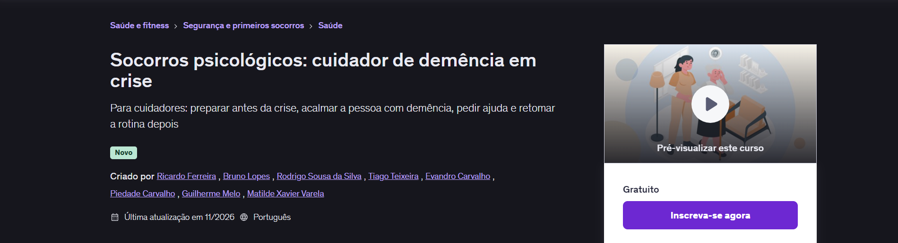
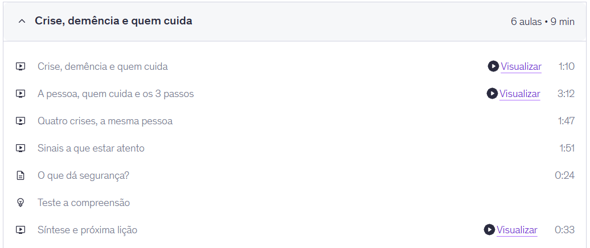
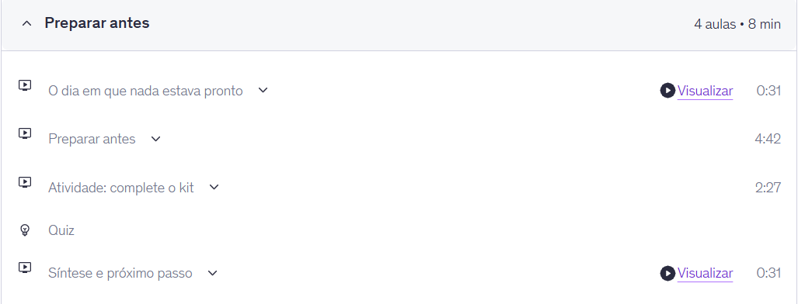
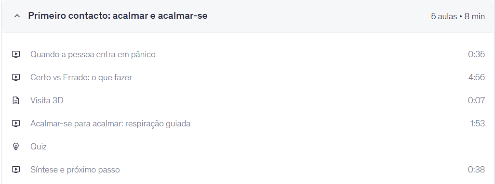
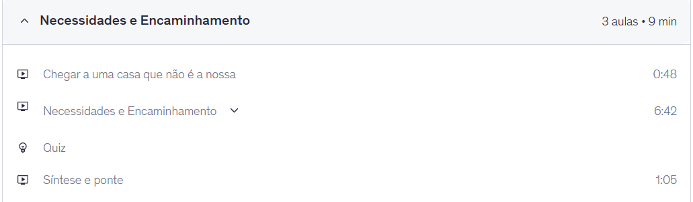
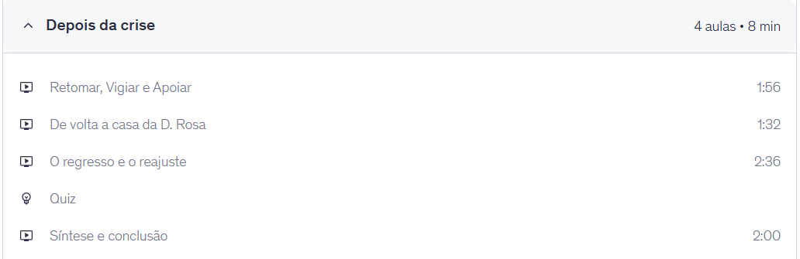

# S8 — Regras e diretrizes da Udemy: como o curso as cumpre

Nota de trabalho (04/11), para a pasta `05_Regras_Udemy` do .zip (exportar para PDF). Curso: «Socorros psicológicos: cuidador de demência em crise». Atualizado a 10/11: curso submetido para revisão a 07/11 (manhã), aprovado e publicado a 09/11.

**Fontes:** centro de ajuda da Udemy para instrutores (*Course quality checklist*, *The Free Course Experience*, *Audio Standards*, *Describing your intended learners*, *Practice Activities: Quality Standards*), já usadas na análise de plataformas do S1. As regras que não estão nestas páginas confirmaram-se na lista que a Udemy mostra ao «Enviar para revisão».

---

## 1. Porque a Udemy (resumo do S1)

Gratuita, sem servidor para manter, com regras oficiais e explícitas e uma revisão de qualidade antes de publicar. Isto responde ao critério «integração com a plataforma» (20 % da nota) e ao critério FI02 dos QEF dos anos anteriores («respeitar as guidelines da plataforma»). O preço a pagar: a Udemy não aceita iframes, por isso o Matterport não pode ficar dentro da página.

## 2. Regras obrigatórias para publicar

| # | Regra da Udemy | Como o nosso curso cumpre | Estado |
|---|---|---|---|
| R1 | Pelo menos **5 aulas** | 5 secções (uma por lição), cada uma com 3–6 aulas + 1 teste; 22 aulas no total | ✔ |
| R2 | Pelo menos **30 min de vídeo** | L1 8:33 · L2 8:11 · L3 8:02 · L4 8:35 · L5 8:04 → **41 min** de vídeo na página do curso (5 secções · 22 aulas). A Udemy só deixa submeter com ≥ 30 min | ✔ |
| R3 | Curso **grátis: no máximo 2 h** de vídeo | 41 min | ✔ |
| R4 | Vídeo em **HD** (720p ou mais) | Exportado do PowerPoint em Full HD 1080p | ✔ |
| R5 | **Áudio** claro, nos dois canais, sincronizado com a imagem, sem ruído que distraia | Voz regravada depois dos testes do S7 (estalo, voz abafada); música baixa (4 % na L1); teste de áudio antes de gravar | ✔ (06/11) |
| R6 | **Página do curso** completa: título, subtítulo, descrição, idioma, nível, categoria, imagem | Título (52/60 caracteres), subtítulo (115/120), descrição ≈ 230 palavras, Português, Todos os níveis, Saúde e Fitness → Saúde mental, imagem 750 × 422 sem texto | ✔ (04/11) |
| R7 | **Alunos-alvo:** pelo menos 4 objetivos de aprendizagem, requisitos, para quem é (público concreto, não «todos») | 5 objetivos (um por lição), requisitos «nenhum», 3 públicos concretos (cuidadores informais, familiares, voluntários e técnicos) | ✔ (04/11) |
| R8 | **Perfil do instrutor** com fotografia e biografia | Perfil do instrutor com foto, título e biografia (a Udemy pede pelo menos 50 palavras); sem isto a Udemy não deixa submeter | ✔ (07/11) |
| R9 | **Preço** definido | Grátis | ✔ |
| R10 | **Revisão de qualidade** antes de publicar (≈ 2 dias úteis) | Submetido a 07/11 (manhã); aprovado e publicado: https://www.udemy.com/course/socorros-psicologicos-cuidador-de-demencia-em-crise/ | ✔ |

## 3. Recomendações da Udemy que seguimos

| # | Recomendação | No nosso curso |
|---|---|---|
| D1 | Uma atividade prática por secção | L1 a L4 têm uma atividade (artigo ou vídeo; na L2 com 3 PDFs para preencher) e um teste; a L5 tem só o teste |
| D2 | Aulas curtas, uma ideia por aula | Vídeos de 0:31 a 6:42, cada um com um tema (gancho, conteúdo, aprofundamento, síntese) |
| D3 | Legendas | Legendas em português (pt-PT) feitas a partir do guião, não as automáticas (mais certas nos nomes e números), nas L1, L2 e L3; a L5 ficou sem legendas |
| D4 | Vídeo promocional | Opcional (não é preciso para publicar) |
| D5 | Recursos para descarregar | PDFs da L2 (checklist do kit, ficha da pessoa, plano de apoio), cartão de bolso da L4, links «Visita 3D» |
| D6 | Testes com explicação em cada opção | Todos os testes dão feedback «Certo, porque…» / «Ainda não: …»; depois do S7, a certa deixou de ser sempre a mais longa |

## 4. Limites da Udemy e como os contornámos

| Limite | O que fizemos |
|---|---|
| **Sem iframes:** o Matterport não pode ficar dentro da aula | A visita entra de duas formas: (1) vídeo gravado da visita, com as tags, dentro do vídeo da aula; (2) link «Visita 3D (opcional)» nos recursos. O teste nunca depende do link |
| **Curso grátis:** a Udemy limita as funcionalidades extra (certificado, perguntas e respostas, mensagens) | O que importa para a aprendizagem (vídeo, artigos, recursos, testes) funciona. Testado: o teste aparece aos alunos num curso grátis (15/10 e 03/11) |
| **Avaliação nativa só de escolha múltipla** | Testes da Udemy com feedback; atividades de reflexão em artigo, sem correção automática |
| **Revisão fora do nosso controlo** | Submetido a 07/11 de manhã, aprovado e publicado a 09/11, sem pedidos de correção |

## 5. Evidências (página pública do curso, 10/11)

