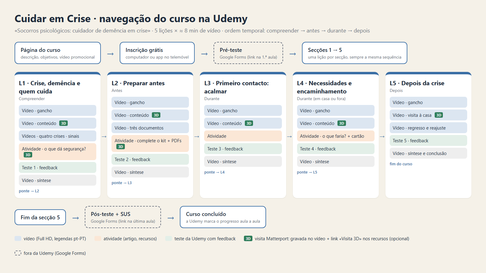
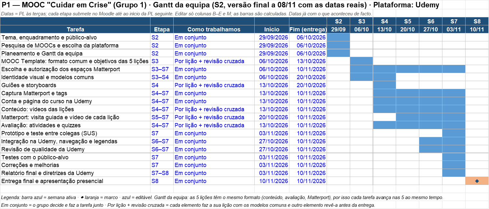

# Cuidar em Crise — Primeiros socorros psicológicos para cuidadores de pessoas com demência

Nota de trabalho (04/11; atualizada a 10/11). Fonte do `S8_Relatorio_Final_Grupo1.pdf` (pasta `02_Relatorio` do .zip). Quem junta: Bruno. **Cada um preenche a secção 3 da sua lição** com os mesmos títulos da L1 (modelo: `L1/S8_Relatorio_L1.md`) até **dom 08/11**. O que só se fecha na terça 10/11 (link público, capturas) está marcado **(terça)**; o que falta de cada um, **[Nome]**.

CAMUL · ISEP · 2026/2027 · P1 · Relatório final

Grupo 1 — Bruno Lopes (1240441) · Tiago Teixeira (1240493) · Rodrigo Silva (1221391) · Ricardo Ferreira (1220901) · Evandro Carvalho (1200929)

Udemy: «Socorros psicológicos: cuidador de demência em crise» · https://www.udemy.com/course/socorros-psicologicos-cuidador-de-demencia-em-crise/

## 1. O curso em resumo

- **Tema e eixo:** Acolher (crise e apoio psicossocial), ligado a Incluir (demência) e Capacitar (quem cuida).
- **Público:** cuidadores informais de pessoas com demência ligeira a moderada, em casa, em Portugal.
- **Situação:** uma crise (incêndio, cheia ou tempestade, pandemia, deslocação por conflito) quebra a rotina e as referências; a pessoa entra em angústia ou agitação e o cuidador fica sobrecarregado.
- **Objetivo geral:** no fim do curso, o cuidador é capaz de se preparar para uma crise e de prestar primeiros socorros psicológicos à pessoa com demência e a si próprio.
- **Diferenciação:** os cursos de PSP são gerais e em inglês; os portugueses para cuidadores tratam o dia a dia, não a crise. O nosso é curto, gratuito, em português e aplica os PSP à dupla cuidador–pessoa com demência.
- **Plataforma:** Udemy (ver secção 5).
- **Fio condutor:** a dupla fictícia D. Rosa (pessoa com demência) e Ana (filha cuidadora), em todas as lições e no Matterport.

## 2. O processo, de S1 a S8

| Etapa | Entrega | O que se decidiu ou fez |
|---|---|---|
| S1 (29/09) | Análise de plataformas | Udemy, Moodle + H5P e Open edX comparados; escolhida a Udemy (o Google Forms para a avaliação externa ficou de fora: a avaliação são os testes Alfa e Beta do S7) |
| S2 (06/10) | MOOC-choice + planning | Tema, público, objetivo, Gantt da equipa; reescrito para um contexto de crise depois da Aula 3 (5 elementos: público, situação, contexto, decisões, Matterport) |
| S3 (13/10) | MOOC Template | As 5 lições em sequência temporal, padrão comum (gancho → vídeo → atividade → teste → síntese); validado a 20/10, com o pedido de pôr as crises também nas atividades e no Matterport |
| S4 (20/10) | Primeiras evidências | Trabalho individual: guião, storyboard, modelo visual comum, atividade e teste na Udemy |
| S5 (27/10) | Protótipo | Ilustrações Storyset, música comum, vídeos em PowerPoint, Matterport em plano B (espaço do Discover) |
| S6 (03/11) | Versão integrada | Voz, vídeos Full HD, legendas, as 5 secções no mesmo curso, Gantt com o progresso real |
| S7 (03/11) | Testes e validação | Alfa (cada autor a sua lição) e Beta (outros grupos); ver secção 8 |
| S8 (10/11) | Entrega final | ≈ 8 min de vídeo por lição, Matterport nas nossas casas com tags (menos na L5), voz regravada com a câmara ligada, curso submetido para revisão a 07/11 e publicado a 09/11 (41 min de vídeo) |

## 3. As lições

Cada lição: papel no curso e objetivos · estrutura final na Udemy (aulas, tipos, durações) · percurso S4 → S8 · decisões que mudaram · multimédia e créditos. Mesmos títulos em todas.

### 3.1 L1 · Crise, demência e quem cuida (Bruno Lopes)

#### Papel da lição no curso

A L1 é a lição «Compreender»: abre o curso e prepara as outras quatro. Mostra como uma crise (incêndio, cheia ou tempestade, pandemia, deslocação por conflito) afeta a pessoa com demência e quem cuida dela, e apresenta os 3 passos dos primeiros socorros psicológicos (OMS, 2011): observar, escutar, encaminhar. Apresenta também a dupla fictícia que acompanha o curso todo: a D. Rosa (pessoa com demência) e a filha Ana (cuidadora).

**Objetivos:** (1) reconhecer como a crise agrava a confusão, o medo e a agitação da pessoa com demência; (2) reconhecer as reações de stress de quem cuida como normais; (3) conhecer os 3 passos dos PSP.

#### Estrutura final na Udemy (secção 1)

| # | Item | Tipo | Duração |
|---|---|---|---|
| 1 | Aula 1 · Crise, demência e quem cuida | Vídeo (gancho) | 1:10 |
| 2 | Aula 2 · A pessoa, quem cuida e os 3 passos | Vídeo, com a visita 3D | 3:12 |
| 3 | Aula 3 · Quatro crises, a mesma pessoa | Vídeo | 1:47 |
| 4 | Aula 4 · Sinais a que estar atento | Vídeo | 1:51 |
| 5 | Aula 5 · O que dá segurança? | Texto (atividade) + link «Visita 3D» | 2 min |
| 6 | Teste 1 · Teste a compreensão | Quiz, 4 perguntas com feedback | 1,5 min |
| 7 | Aula 6 · Síntese e próxima lição | Vídeo (ponte para a L2) | 0:33 |
| | **Total de vídeo** | | **8:33** |

Cada lição tem uma componente para a pessoa (azul) e outra para quem cuida (laranja): na L1, a Aula 2 divide-se em «a pessoa» e «quem cuida», a Aula 4 em «sinais na pessoa» e «sinais em quem cuida», e no Matterport há 8 tags azuis e 1 laranja.

#### Percurso, etapa a etapa

| Etapa | O que se fez na L1 |
|---|---|
| **S4 (20/10)** · primeiras evidências | Plano da lição, guião com a narração exata por cena e storyboard, modelo visual comum aplicado ao PowerPoint, tabela das tags e roteiro da visita 3D, atividade «O que dá segurança?» e Teste 1 (4 perguntas com feedback) já na Udemy |
| **S5 (27/10)** · protótipo | Ilustrações Storyset (estilo Amico), ícones das 4 crises, infografia dos 3 passos, música («High Class», Benjamin Andrews) e sons (relógio, sirene). Matterport em plano B: espaço público do Discover («La Tarasca», Zamora), gravado em vídeo (58 s) com 6 etiquetas feitas no PowerPoint por cima do vídeo |
| **S6 (03/11)** · versão integrada | Voz gravada no PowerPoint; 3 vídeos exportados em Full HD (Aula 1 0:56 · Aula 2 2:44 · síntese 0:20); secção 1 montada na Udemy (5 itens); legendas em português feitas a partir da narração; link «Visita 3D» nos recursos |
| **S7 (03/11)** · testes | Teste Alfa da L1 e Beta de 3 cursos de outros grupos; o nosso curso foi testado por outros grupos (ver secção 8) |
| **S8 (10/11)** · versão final | L1 com 8:33 de vídeo (2 aulas novas, 17 diapositivos), visita 3D numa casa real capturada com o iPhone e 9 tags dentro do Matterport, voz toda regravada, música mais baixa, legendas novas (5), curso submetido para revisão a 07/11 |

#### Decisões que mudaram e porquê

| Antes | Depois | Porquê |
|---|---|---|
| Matterport: espaço público do Discover, etiquetas no PowerPoint | **Casa do Bruno**, capturada com a app Matterport Capture (iPhone com LiDAR), espaço «não listado», 9 tags dentro do Matterport | Pedido da professora (03/11) e testes Beta: o espaço tem de ser nosso e ter tags. A casa foi preparada antes da captura (sem fotografias, documentos nem nada que identifique a morada) e apresenta-se como a casa fictícia da D. Rosa. Lição aprendida: faltou um ponto de captura na porta corredor–cozinha e o plano grátis não deixa voltar a carregar o espaço, por isso na visita passa-se de divisão em divisão pelas tags |
| L1 com ≈ 4 min de vídeo (3 vídeos) | 8:33 (5 vídeos): Aula 3 «Quatro crises, a mesma pessoa» e Aula 4 «Sinais a que estar atento» | Só os vídeos contam para os ≈ 8 min da lição, e a Udemy só publica um curso grátis com ≥ 30 min de vídeo |
| As crises só no gancho (o incêndio como exemplo) | Uma crise por diapositivo na Aula 3 e nas tags (janela, cozinha, porta) e nas 4 perguntas do teste | Feedback do S3: os cenários de crise também nas atividades e no Matterport |
| Voz do S6, sem cara | Voz toda regravada **com a câmara ligada** (o autor num canto de cada diapositivo, menos na visita 3D), música de 15 % para 4 % | Testes do S7: estalo do microfone, música alta, voz abafada; um membro do grupo tem de aparecer no vídeo (professora) |
| Curso só em pré-visualização | Curso submetido para revisão na Udemy a 07/11 | Requisito da entrega final |

#### Multimédia e créditos

- **Vídeo:** PowerPoint → vídeo Full HD 1080p, com a narração e os tempos gravados; um vídeo por aula.
- **Ilustrações:** Storyset (storyset.com), estilo Amico, com atribuição.
- **Música:** «High Class», Benjamin Andrews (Biblioteca de Áudio do YouTube), a 4 %.
- **Visita 3D:** Matterport, casa capturada pelo grupo; link «Visita 3D (opcional)» nos recursos das Aulas 2 e 5 (https://my.matterport.com/show/?m=byVsURgSaSF, «não listado»); vídeo da visita de 69 s na Aula 2, com 6 das 9 tags.
- **Fontes do conteúdo:** OMS (2011) *Psychological First Aid*; ADI (2019) *Forgotten in a Crisis*; ADI (2022) *Advice for carers… during times of crisis*.
- **Acessibilidade:** legendas em português (pt-PT) em todos os vídeos, feitas a partir do guião; texto curto; cores com contraste; azul = pessoa, laranja = quem cuida em todo o lado.

### 3.2 L2 · Preparar antes (Tiago Teixeira)

#### Papel da lição no curso

A L2 é a lição «Antes»: vem a seguir à L1 (compreender) e prepara a casa e a dupla para a crise, antes de ela chegar. Continua a história da L1: o mesmo alerta de incêndio, agora visto por quem **não** estava preparado (a Ana corre de gaveta em gaveta e a D. Rosa fica cada vez mais agitada). Daí parte para três coisas que se preparam hoje.

**Objetivos:** (1) montar um kit de emergência adaptado à pessoa com demência; (2) preencher a ficha da pessoa (medicação, como comunica, o que a acalma, o que a perturba, contactos); (3) definir um plano de apoio para quem cuida (rede de contactos e quem a substitui).

#### Estrutura final na Udemy (secção 2)

| # | Item | Tipo | Duração |
|---|---|---|---|
| 1 | Aula 7 · O dia em que nada estava pronto | Vídeo (gancho) | 0:31 |
| 2 | Aula 8 · Preparar antes | Vídeo: kit, visita 3D, ficha da pessoa, plano de apoio, ficar ou sair, «Três crises, o mesmo kit» | 4:42 |
| 3 | Aula 9 · Atividade: complete o kit | Vídeo (atividade) + texto + 3 PDFs (checklist do kit, ficha da pessoa, plano de apoio) + link «Visita 3D» | 2:27 |
| 4 | Teste 2 · Quiz | Quiz, 4 perguntas com feedback | 1,5 min |
| 5 | Aula 10 · Síntese e próximo passo | Vídeo (ponte para a L3) | 0:31 |
| | **Total de vídeo** | | **8:11** |

Componente para a pessoa (azul): o kit e a ficha da pessoa. Componente para quem cuida (laranja): o plano de apoio. No Matterport há 7 tags azuis e 1 laranja.

#### Percurso, etapa a etapa

| Etapa | O que se fez na L2 |
|---|---|
| **S4 (20/10)** · primeiras evidências | Plano da lição, guião com a narração exata por cena e storyboard, PowerPoint no modelo comum, 3 recursos em PDF (checklist do kit, ficha da pessoa, plano de apoio), secção 2 criada na Udemy com a atividade «Complete o kit» e o Teste 2 (4 perguntas com feedback) |
| **S5 (27/10)** · protótipo | Crises na atividade e nas tags (feedback do S3). Ilustrações Storyset (estilo Amico) recoloridas, planos de pormenor dos objetos do kit filmados com o telemóvel, música e sons da L1, voz gravada no PowerPoint. Matterport em plano B: o espaço do Discover «La Tarasca», o mesmo da L1, com a visita «Caça ao kit» gravada (66 s) e 8 etiquetas feitas no PowerPoint por cima do vídeo |
| **S6 (03/11)** · versão integrada | Legendas em português nos 3 vídeos (publicadas a 27/10); secção 2 verificada como aluno, já com as 5 secções no curso; 3:54 de vídeo (Aula 5 0:33 · Aula 6 2:59 · síntese 0:22) |
| **S7 (03/11)** · testes | Teste Alfa da L2 e Beta de cursos de outros grupos; o nosso curso foi testado por outros grupos (ver secção 8) |
| **S8 (10/11)** · versão final | L2 com 8:11 de vídeo (4 vídeos, 21 diapositivos), voz toda regravada com a câmara ligada, visita 3D regravada na casa da D. Rosa com 8 tags dentro do Matterport, atividade também em vídeo, bloco novo «Três crises, o mesmo kit», legendas novas (4), Teste 2 com as certas noutras posições |

#### Decisões que mudaram e porquê

| Antes | Depois | Porquê |
|---|---|---|
| Matterport: espaço público do Discover, etiquetas no PowerPoint | Espaço «Casa D. Rosa» (casa do Bruno, capturada a 06/11, o mesmo da L1) com **8 tags da L2 dentro do Matterport** (3 com as crises: caminho livre, rede de apoio, o kit); visita regravada (1:39) com o balão de cada tag aberto | Pedido da professora (03/11) e testes Beta: o espaço tem de ser nosso e ter tags. A mesma casa nas duas lições mantém a casa da D. Rosa igual para o aluno; cada lição tem as suas tags |
| L2 com 3:54 de vídeo (3 vídeos) | 8:11 (4 vídeos): a atividade passou a vídeo («Complete o kit», 2:27) e a Aula 8 ganhou o bloco «Três crises, o mesmo kit» | Só os vídeos contam para os ≈ 8 min, e a Udemy só publica um curso grátis com ≥ 30 min de vídeo. Os blocos novos não trazem matéria nova: passam para vídeo a atividade e as crises do teste e das tags. Uma proposta de 04/11 (casa do Tiago, aula nova «Os três documentos») ficou de fora |
| As crises só no gancho (o incêndio) | Incêndio, cheia e conflito armado na atividade, em 3 tags e no bloco «Três crises, o mesmo kit» (o que pesa mais em cada crise) | Feedback do S3: os cenários de crise também nas atividades e no Matterport |
| Voz do S5, sem cara | Voz toda regravada **com a câmara ligada** (o autor num canto, longe dos balões das tags na visita 3D), música mais baixa e em todos os diapositivos | Um membro do grupo tem de aparecer no vídeo (professora, 03/11) |
| Teste 2 com a certa em B, B, A, B (e a mais longa) | Certas em A, C, B, C | Testes do S7: a resposta certa era fácil de adivinhar |
| PDFs com nomes de trabalho (etapa e lição) | PDFs com nomes claros (checklist do kit, ficha da pessoa, plano de apoio) | A Udemy mostra o nome do ficheiro aos alunos |

#### Multimédia e créditos

- **Vídeo:** PowerPoint (modelo comum, 21 diapositivos) → vídeo Full HD 1080p, com a narração, a câmara e os tempos gravados; um vídeo por aula.
- **Ilustrações:** Storyset (storyset.com), estilo Amico, recoloridas (azul = D. Rosa, laranja = Ana), com atribuição. **Planos de pormenor** filmados com o telemóvel (só mãos e objetos, sem nomes nem dados reais).
- **Música e sons:** «High Class», Benjamin Andrews (Biblioteca de Áudio do YouTube), a mesma da L1; sirene e relógio da L1 no gancho.
- **Visita 3D:** Matterport, espaço «Casa D. Rosa» (o mesmo da L1, «não listado»), visita «Caça ao kit» de 1:39 dentro da Aula 8, 8 paragens com o balão da tag aberto; link «Visita 3D (opcional)» na Aula 9; nenhum teste depende do link.
- **Recursos:** 3 PDFs A4 para descarregar (checklist do kit, ficha da pessoa, plano de apoio); no vídeo da atividade, a ficha e o plano aparecem preenchidos com dados fictícios da D. Rosa e da Ana.
- **Fontes do conteúdo:** Alzheimer's Association, *In a Disaster* (lista do kit); ADI (2022) *Advice for carers… during times of crisis*; Peterson et al. (2023) e Donohoe et al. (2023), preparação para catástrofes de quem cuida de pessoas com demência.
- **Acessibilidade:** legendas em português (pt-PT) nos 4 vídeos (8 + 61 + 32 + 6), com o texto do guião e os tempos medidos na fala; azul = pessoa, laranja = quem cuida.

### 3.3 L3 · Primeiro contacto: acalmar (Rodrigo Silva)

#### Papel da lição no curso

A L3 é a lição «Durante» (primeiro contacto): vem a seguir à L2, que prepara a casa e a dupla, e mostra o que fazer nos primeiros minutos da crise. Retoma a D. Rosa e a Ana na casa da D. Rosa e responde à pergunta «como falo com alguém em pânico?». Mostra a mesma cena duas vezes (a versão errada e a certa) para o aluno ver que o tom pesa mais do que as palavras e que a calma começa em quem cuida. Resume-se no acrónimo P.A.R.A.R.: Pausa, Aproximar-se, Reduzir estímulos, Acolher, Reconfortar.

**Objetivos:** (1) reconhecer os sinais de angústia da pessoa e os sinais de stress em quem cuida; (2) acalmar-se antes de falar (pausa de 10 s, inspirar contando até 4, expirar contando até 6); (3) aproximar-se e falar de forma que acalme (frases que agravam vs frases que acalmam, uma ideia por frase); (4) reduzir os estímulos da casa (televisão, janelas, portas, espelhos) e criar um canto calmo com um objeto de conforto.

#### Estrutura final na Udemy (secção 3)

| # | Item | Tipo | Duração |
|---|---|---|---|
| 1 | Aula 11 · Quando a pessoa entra em pânico | Vídeo (gancho) | 0:35 |
| 2 | Aula 12 · Certo vs Errado: o que fazer | Vídeo, com a visita 3D | 4:56 |
| 3 | Aula 13 · Visita 3D | Texto (artigo) com o link «Visita 3D» | - |
| 4 | Aula 14 · Acalmar-se para acalmar: respiração guiada | Vídeo (atividade) | 1:53 |
| 5 | Teste 3 · Teste a compreensão | Quiz, 4 perguntas com feedback | 1,5 min |
| 6 | Aula 15 · Síntese e próxima lição | Vídeo (ponte para a L4) | 0:38 |
| | **Total de vídeo** | | **8:02** |

Componente para a pessoa (azul): reduzir estímulos e o canto calmo. Componente para quem cuida (laranja): reconhecer os sinais em si e respirar antes de falar. No Matterport há 11 tags, 10 azuis e 1 laranja.

#### Percurso, etapa a etapa

| Etapa | O que se fez na L3 |
|---|---|
| **S4 (20/10)** · primeiras evidências | Plano da lição, guião com a narração por cena, PowerPoint no modelo comum (10 diapositivos), atividade «Respiração guiada» e Teste 3 (4 perguntas com feedback) na Udemy |
| **S5 (27/10)** · protótipo | Matterport em plano B: espaço público do Discover («La Tarasca»), visita à sala gravada e incluída no vídeo, com 5 pontos destacados |
| **S6 (03/11)** · versão integrada | Voz gravada no PowerPoint, secção 3 montada na Udemy com as 5 secções do curso |
| **S7 (03/11)** · testes | Teste Alfa da L3 (ver secção 8): voz com nível diferente, sem legendas, ≈ 4 min de vídeo |
| **S8 (10/11)** · versão final | L3 com 8:02 de vídeo (4 vídeos, 13 diapositivos), 3 diapositivos novos (sinais de angústia em quem cuida, frases que agravam vs frases que acalmam, «E se a pessoa continua a recusar?»), respiração guiada alargada para 1:53, visita 3D na casa da D. Rosa com 11 tags, voz regravada, legendas novas (3) |

#### Decisões que mudaram e porquê

| Antes | Depois | Porquê |
|---|---|---|
| L3 com ≈ 4 min de vídeo | 8:02 (4 vídeos): 3 diapositivos novos e a respiração guiada alargada | Só os vídeos contam para os ≈ 8 min, e a Udemy só publica um curso grátis com ≥ 30 min de vídeo. Os blocos novos aprofundam o que já estava (sinais, frases, recusa) |
| Matterport: espaço do Discover, etiquetas no PowerPoint | Sala da D. Rosa, com 11 tags dentro do Matterport | Pedido da professora (03/11) e testes Beta: o espaço tem de ser nosso e ter tags |
| Sem legendas | Legendas em português (pt-PT) nos 3 vídeos com fala | Teste Alfa: faltavam legendas |
| Voz com nível diferente, música alta | Voz regravada e música mais baixa | Teste Alfa e Beta |
| Voz sem cara | Câmara ligada na regravação exceto nos diapositivos de versão certa e versão errada | Um membro do grupo tem de aparecer no vídeo (professora, 03/11) |

#### Multimédia e créditos

- **Vídeo:** PowerPoint (modelo comum, 13 diapositivos) → vídeo Full HD 1080p, com a narração e os tempos gravados; um vídeo por aula.
- **Ilustrações:** originais, criadas para a lição no modelo visual comum, com apoio de IA.
- **Música:** «High Class», Benjamin Andrews (Biblioteca de Áudio do YouTube), a mesma das outras lições.
- **Visita 3D:** Matterport, sala da D. Rosa, 11 tags, vídeo da visita dentro da Aula 12; link «Visita 3D (opcional)» na Aula 13; nenhum teste depende do link.
- **Fontes do conteúdo:** OMS (2011) *Psychological First Aid*; ADI (2022) *Advice for carers… during times of crisis*.
- **Acessibilidade:** legendas em português (pt-PT) nos 3 vídeos com fala (Gancho, Certo vs Errado, Síntese); azul = pessoa, laranja = quem cuida.

### 3.4 L4 · Necessidades e encaminhamento (Ricardo Ferreira)

#### Papel da lição no curso

A L4 é uma lição «Durante»: depois do primeiro contacto e de acalmar, mostra o que fazer quando a D. Rosa e a Ana chegam a um ambiente diferente do habitual. A casa onde são acolhidas serve para pensar na segurança, nas necessidades imediatas e no pedido de ajuda, tanto para a pessoa com demência como para quem cuida.

**Objetivos:** (1) identificar necessidades e perigos no novo espaço; (2) comunicar o que a pessoa precisa e reconhecer quando encaminhar para ajuda adequada; (3) reconhecer as necessidades do cuidador e pedir apoio.

#### Estrutura final na Udemy (secção 4)

| # | Item | Tipo | Duração |
|---|---|---|---|
| 1 | Aula 16 · Chegar a uma casa que não é a nossa | Vídeo (gancho) | 0:48 |
| 2 | Aula 17 · Necessidades e Encaminhamento | Vídeo + cartão de bolso | 6:42 |
| 3 | Teste 4 | Quiz, 4 perguntas de escolha múltipla, com uma resposta certa e duas erradas | — |
| 4 | Aula 18 · Síntese e ponte | Vídeo (ponte para a L5) | 1:05 |
| | **Total de vídeo** | | **8:35** |

O cartão de bolso apoia a aplicação dos conteúdos; o quiz permite verificar a compreensão. Não contam para a duração de vídeo.

#### Percurso, etapa a etapa

| Etapa | O que se fez na L4 |
|---|---|
| **S4 (20/10)** · primeiras evidências | Definição da lição, do cenário de acolhimento, do guião e da avaliação; as evidências próprias da L4 foram reunidas no S5 |
| **S5 (27/10)** · protótipo | Guião e storyboard, ilustrações, cartão de bolso, proposta de visita 3D e quiz; entrega do protótipo |
| **S6 (03/11)** · versão integrada | Integração da lição na Udemy, com um pequeno atraso; no teste de 03/11 ainda faltavam a narração e as legendas |
| **S7 (03/11)** · testes | Teste Alfa aos vídeos, ao quiz e às legendas; o quiz funcionou, mas faltavam a narração e as legendas |
| **S8 (10/11)** · versão final | Estrutura final com 3 vídeos e 8:35 de vídeo na Udemy, cartão de bolso, quiz, legendas e visita Matterport no apartamento do Ricardo, com 7 tags |

#### Decisões que mudaram e porquê

| Antes | Depois | Porquê |
|---|---|---|
| Visita 3D num centro de acolhimento | Apartamento do Ricardo, apresentado como casa de familiares ou amigos que acolhem a D. Rosa e a Ana | A professora pediu que o espaço fosse capturado pelos estudantes; a casa permite trabalhar a chegada e a adaptação a um local desconhecido |
| Estrutura anterior com dois vídeos de conteúdo | Um vídeo de conteúdo, entre o gancho e a síntese | A lição foi reorganizada durante a produção; a versão final reúne o conteúdo em «Necessidades e Encaminhamento» |
| Vídeos sem narração e sem legendas no teste Alfa | Narração e legendas nos vídeos finais | Corrigir as falhas encontradas no teste e tornar os conteúdos acessíveis |

#### Multimédia e créditos

- **Vídeo:** 3 vídeos com a narração: gancho, conteúdo e síntese com a ponte para a L5.
- **Ilustrações:** imagens da chegada, das necessidades e do pedido de ajuda, em estilo semelhante ao modelo visual comum.
- **Visita 3D:** Matterport capturado no apartamento do Ricardo, com 7 tags; o espaço representa a casa de familiares ou amigos que acolhem temporariamente a D. Rosa e a Ana.
- **Recurso:** cartão de bolso para consultar as necessidades, os sinais de alarme e os contactos de ajuda.
- **Fontes do conteúdo:** OMS (2011) *Psychological First Aid*; ADI (2022) *Advice for carers during times of crisis*; Alzheimer's Association, *In a Disaster*.
- **Acessibilidade:** legendas em português nos 3 vídeos.

### 3.5 L5 · Depois da crise (Evandro Carvalho)

#### Papel da lição no curso

A L5 é a lição «Depois»: fecha o percurso do MOOC a seguir à L4. Mostra como gerir o regresso a casa e o reajuste gradual após uma crise, dando atenção especial à exaustão acumulada do cuidador e aplicando a tríade de primeiros socorros psicológicos (Observar, Escutar, Encaminhar) para recuperar o equilíbrio e garantir o apoio de que ambos precisam.

**Objetivos:** (1) compreender que o reajuste pós-crise exige tempo, paciência e a retoma gradual das rotinas; (2) reconhecer que o cansaço e a exaustão do cuidador se prolongam e requerem atenção ativa e autocuidado; (3) aplicar os 3 passos para recuperar a estabilidade emocional e comunitária.

#### Estrutura final na Udemy (secção 5)

| # | Item | Tipo | Duração |
|---|---|---|---|
| 1 | Aula 19 · Retomar, Vigiar e Apoiar | Vídeo (gancho: os pilares do regresso) | 1:56 |
| 2 | Aula 20 · De volta a casa da D. Rosa | Vídeo, com a visita 3D | 1:32 |
| 3 | Aula 21 · O regresso e o reajuste | Vídeo (os 3 passos depois da crise) | 2:36 |
| 4 | Teste 5 · Quiz | Quiz, 4 perguntas com feedback | 1,5 min |
| 5 | Aula 22 · Síntese e conclusão | Vídeo (fecho do curso) | 2:00 |
| | **Total de vídeo** | | **8:04** |

Componente para a pessoa (azul): voltar às referências e à rotina das refeições, aos poucos. Componente para quem cuida (laranja): a exaustão que fica depois da crise e o pedido de ajuda. Na visita 3D há 4 etiquetas azuis e 1 laranja.

#### Percurso, etapa a etapa

| Etapa | O que se fez na L5 |
|---|---|
| **S4 (20/10)** · primeiras evidências | Plano da lição, guião com a narração exata por cena e storyboard, modelo visual comum aplicado ao PowerPoint, estrutura da visita 3D e Teste 5 (4 perguntas de escolha múltipla com feedback) criado na Udemy |
| **S5 (27/10)** · protótipo | Ilustrações Storyset (estilo Amico), infografia dos pilares de regresso, música («High Class», Benjamin Andrews). Matterport em plano B: espaço do Discover («La Tarasca», Zamora), integrado com a visita gravada e etiquetas criadas no PowerPoint alusivas ao pós-crise (reconhecimento de referências, retoma de rotinas de refeição, descanso do cuidador) |
| **S6 (03/11)** · versão integrada | Voz gravada no PowerPoint; vídeos exportados em Full HD; secção 5 montada na Udemy |
| **S7 (03/11)** · testes | Teste Alfa da L5 e Beta cruzado com outros grupos (revisão de aspetos de áudio e clareza das opções de teste) |
| **S8 (10/11)** · versão final | L5 com 8:04 de vídeo (4 vídeos), voz regravada com a câmara ligada, Teste 5 com feedback em cada opção; a Aula 22 fecha o curso todo (as 5 lições) |

#### Decisões que mudaram e porquê

| Antes | Depois | Porquê |
|---|---|---|
| L5 focada apenas numa síntese muito rápida e sem aprofundar o pós-crise | Aprofundamento estruturado em 4 pilares (regresso, rotina, vigilância, apoio) e aplicação prática dos 3 passos | Garantir simetria pedagógica com as lições anteriores e dar relevo ao desgaste invisível do cuidador no pós-crise |
| Matterport com foco genérico no espaço | Visita guiada focada especificamente no pós-crise (espaço familiar, retoma de horários de refeição, espaço de descanso do cuidador) | Alinhamento com o feedback do S3 para que as temáticas da lição se reflitam diretamente no espaço 3D |
| Voz do S6, sem cara | Voz regravada com a câmara ligada (o autor num canto do diapositivo) | Um membro do grupo tem de aparecer no vídeo (professora, 03/11) |
| Teste 5 com opções iniciais muito desequilibradas | Refinamento das 4 perguntas e respetivos feedbacks detalhados em cada alínea («Certo, porque…» / «Ainda não:…») | Assegurar que o teste funciona como ferramenta de aprendizagem autónoma na Udemy |

#### Multimédia e créditos

- **Vídeo:** PowerPoint (modelo comum, 10 diapositivos) → vídeo Full HD 1080p, com a narração, a câmara e os tempos gravados; um vídeo por aula.
- **Ilustrações:** Storyset (storyset.com), estilo Amico, com atribuição; ícones dos pilares do regresso (regresso, rotina, vigilância, apoio) e dos 3 passos (observar, escutar, encaminhar).
- **Música:** «High Class», Benjamin Andrews (Biblioteca de Áudio do YouTube), a mesma das outras lições.
- **Visita 3D:** Matterport, espaço público do Discover «La Tarasca» (plano B do S5), gravado em vídeo dentro da Aula 20, com 5 etiquetas sobre o pós-crise (quadros, sofá, cozinha, quarto, porta) feitas no PowerPoint por cima do vídeo.
- **Fontes do conteúdo:** OMS (2011) *Psychological First Aid*; ADI (2019) *Forgotten in a Crisis*; ADI (2022) *Advice for carers… during times of crisis*.
- **Acessibilidade:** azul = pessoa, laranja = quem cuida; os vídeos da L5 ficaram sem legendas.

### Tabela comum (soma dos vídeos)

| Lição | Aulas de vídeo | Vídeo (min) | Atividade | Teste | Matterport (casa, n.º de tags) |
|---|---|---|---|---|---|
| L1 | 5 | 8:33 | O que dá segurança? | Teste 1 (4) | casa do Bruno, 9 |
| L2 | 4 | 8:11 | Complete o kit (vídeo + 3 PDFs) | Teste 2 (4) | casa do Bruno (o mesmo espaço da L1), 8 |
| L3 | 4 | 8:02 | Respiração guiada (vídeo) | Teste 3 (4) | sala do Rodrigo, 11 |
| L4 | 3 | 8:35 | Cartão de bolso (recurso) | Teste 4 (4) | apartamento do Ricardo, 7 |
| L5 | 4 | 8:04 | — (só o teste) | Teste 5 (4) | Discover «La Tarasca» (plano B), 5 etiquetas no vídeo |
| **Total** | **20** | **41 min** (Udemy: 5 secções · 22 aulas) | | | |

## 4. Matterport

- Cada lição usa uma casa capturada pelo grupo com a app Matterport Capture, apresentada como a casa fictícia da D. Rosa e da Ana (L1 e L2: casa do Bruno, o mesmo espaço «Casa D. Rosa», cada lição com as suas tags; L3: sala do Rodrigo, representa a «Sala da D. Rosa», 11 tags; L4 usa o apartamento do Ricardo como casa de acolhimento temporário, com 7 tags). A L5 ficou com o plano B do S5: o espaço público do Discover «La Tarasca», em vídeo, com 5 etiquetas feitas no PowerPoint.
- **Tags:** azul = pessoa com demência, laranja = quem cuida; título com o prefixo da lição (ex.: «L1 · Sofá»); as crises aparecem nas tags (feedback do S3). A L4 usa cores por tipo de lugar (verde = referência e saída, vermelho = perigo).
- **Na Udemy:** a Udemy não aceita iframes → vídeo gravado da visita dentro da aula + link «Visita 3D (opcional)» nos recursos; nenhum teste depende do link.
- **Privacidade:** espaços «não listados»; casas preparadas antes da captura (sem fotografias de família, documentos, morada); ninguém nas divisões capturadas; nunca uma pessoa com demência real.

## 5. Integração com a Udemy

A Udemy foi escolhida no S1 por ser gratuita, sem servidor e por ter regras oficiais e uma revisão de qualidade antes de publicar. O curso cumpre todas as regras para publicar:

| Regra da Udemy | No nosso curso |
|---|---|
| Pelo menos 5 aulas | 5 secções, 22 aulas e 5 testes |
| Pelo menos 30 min de vídeo; grátis, no máximo 2 h | 41 min (L1 8:33 · L2 8:11 · L3 8:02 · L4 8:35 · L5 8:04) |
| Vídeo HD (720p ou mais) | Full HD 1080p, exportado do PowerPoint |
| Áudio claro, sem ruído | Voz regravada depois dos testes do S7, música baixa |
| Página do curso completa | Título, subtítulo, descrição, Português, todos os níveis, Saúde e Fitness → Saúde mental, imagem 750 × 422 |
| Alunos-alvo | 5 objetivos de aprendizagem (um por lição), sem requisitos, 3 públicos concretos |
| Perfil do instrutor | Fotografia, título e biografia (pelo menos 50 palavras) |
| Preço | Grátis |
| Revisão de qualidade | Submetido a 07/11 de manhã, aprovado e publicado a 09/11 |

Segue também as recomendações: um teste com feedback em cada secção e uma atividade nas L1 a L4, aulas curtas com uma ideia cada, legendas em português feitas a partir do guião (L1 a L4) e recursos para descarregar (PDFs da L2, cartão de bolso da L4, links «Visita 3D»).

O maior limite é a Udemy não aceitar iframes: o Matterport entra como vídeo gravado da visita, com as tags, dentro da aula, e como link «Visita 3D (opcional)» nos recursos; nenhum teste depende do link.

**Fontes:** centro de ajuda da Udemy para instrutores (*Course quality checklist*, *The Free Course Experience*, *Audio Standards*, *Describing your intended learners*, *Practice Activities: Quality Standards*).

## 6. Navegação do curso

O aluno entra pela página do curso, inscreve-se (grátis) e segue as 5 secções por ordem: L1 Compreender → L2 Antes → L3 Durante → L4 Durante (casa ou fora) → L5 Depois. Em cada secção: vídeos (gancho, conteúdo, aprofundamento) → atividade → teste → síntese com a ponte para a lição seguinte. Nas aulas com Matterport há um link «Visita 3D (opcional)» nos recursos. A Udemy guarda o progresso e deixa voltar a qualquer aula.

## 7. Gantt final

O Gantt da equipa do S2 foi mantido até ao fim, com as datas reais. O que mudou face ao plano:

- **Matterport:** previsto para S3–S5; no S5 ficou em plano B (Discover) e, depois do pedido de 03/11, cada lição capturou a sua casa com tags (03/11 → 06/11).
- **Vídeos:** previstos até ao S6; depois dos testes do S7 foram alargados para ≈ 8 min por lição e regravados.
- **Teste com o público (SUS):** passou para os testes Alfa e Beta da PL de 03/11; o Google Forms foi cortado a 04/11.
- **Revisão da Udemy:** prevista para S6–S7; o curso foi submetido a 07/11, quando chegou aos 30 min de vídeo, e publicado a 09/11.

## 8. Testes e melhorias (S7)

**Como se testou:** PL de 03/11, folha de testes do Moodle. Alfa: cada autor fez a sua lição do princípio ao fim. Beta: alunos de outros grupos testaram o nosso curso, e cada um de nós testou cursos de outros grupos (só na L1: 5 registos Beta sobre a lição e o curso; o Bruno testou 3 cursos de outros grupos, 12 tarefas).

**O que os outros grupos disseram do nosso curso (Beta):**

| Problema | Lições | Melhoria |
|---|---|---|
| Pouco vídeo (≈ 5 min na secção 1) | todas | ≈ 8 min de vídeo por lição |
| Matterport sem tags (espaço do Discover) | todas | Casas próprias, tags dentro do Matterport |
| Música alta, voz abafada | L1 (e outras) | Voz regravada, música mais baixa |
| Nenhum membro do grupo no vídeo | todas | Câmara ligada na regravação |
| A resposta certa do teste é a mais longa | L1, L2 | Opções reescritas (já na Udemy) |

**O que funcionou bem (Beta):** a navegação e a ordem das aulas, o feedback do teste em todas as opções, o artigo da atividade da L1 («muito rico em recursos complementares»).

**Alfa, por lição:** L1: 7 de 7 tarefas funcionais; estalo do microfone no início dos vídeos, visita 3D quase sem narração, legendas automáticas diferentes da narração; melhorias: voz regravada com 1 s de silêncio antes de falar, o texto passou para as tags dentro da visita, legendas a partir do guião · L2: posição das certas no Teste 2 (passam a A, C, B, C), nota «opcional» no link 3D, crises nas tags, PDFs com nomes para os alunos (06/11); mais as melhorias comuns da tabela acima (8:11 de vídeo, tags no Matterport, câmara ligada) · L3: voz com nível diferente, sem legendas, ≈ 4 min de vídeo; melhorias: 8:02 de vídeo, legendas, voz e música regravadas · L4: a narração e as legendas faltavam nos vídeos; o quiz de 4 perguntas funcionava. Na versão final, os vídeos foram reorganizados, receberam narração e legendas e as falhas identificadas ficaram resolvidas · L5: microfone abafado, sem legendas; melhorias: 8:04 de vídeo, voz regravada com a câmara ligada, feedback em cada opção do Teste 5; as legendas ficaram por fazer.

## 9. Quem fez o quê

| Elemento | Lição | Tarefas de grupo |
|---|---|---|
| Bruno Lopes | L1 | Modelo visual comum, página do curso na Udemy, esquema de navegação, regras da Udemy, relatório e .zip |
| Tiago Teixeira | L2 | Repositório GitHub do grupo (criado a 10/10, ramos por lição, Git LFS para os PowerPoint com vídeo a 06/11), recursos comuns do S5 (ilustrações Storyset, estilo Amico, e música «High Class»), curso na Udemy |
| Rodrigo Silva | L3 | Guião, vídeos, teste e legendas da L3 |
| Ricardo Ferreira | L4 | Guião, vídeos, quiz e legendas da L4 |
| Evandro Carvalho | L5 | Guião, vídeos, visita 3D e Teste 5 da L5; síntese final do curso (Aula 22) |

## 10. O que aprendemos

Testar com outros grupos mostrou problemas que o autor não vê na sua própria lição: o estalo do microfone, a música alta, a resposta certa ser sempre a mais longa. Uma regra da plataforma (≥ 30 min de vídeo para publicar) mudou o desenho das lições na última semana: convém ler as regras de publicação logo no início. O modelo comum (diapositivos, ilustrações, cores azul/laranja, música) poupou tempo e deu coerência a 5 lições feitas por 5 pessoas. Capturar um espaço no Matterport pede preparação: planear os pontos de captura e tirar da casa tudo o que identifica quem lá vive.

## 11. Créditos e fontes

- Ilustrações: Storyset (storyset.com), estilo Amico (L3: originais, feitas com apoio de IA) · Música: «High Class», Benjamin Andrews (Biblioteca de Áudio do YouTube) · Visitas 3D: Matterport, casas capturadas pelo grupo (L5: espaço público do Discover «La Tarasca», Zamora).
- Conteúdo: OMS (2011) *Psychological First Aid* · Alzheimer's Association *In a Disaster* · ADI (2019) *Forgotten in a Crisis* · ADI (2022) *Advice for carers… during times of crisis* · Peterson et al. (2023) e Donohoe et al. (2023) · Alzheimer Portugal · OCDE (2017) · ISS (out. 2025) · Lei n.º 100/2019 (Estatuto do Cuidador Informal).
