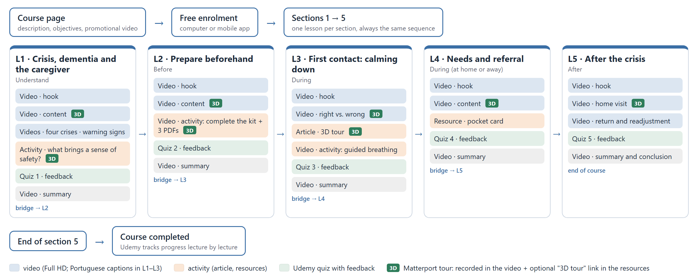
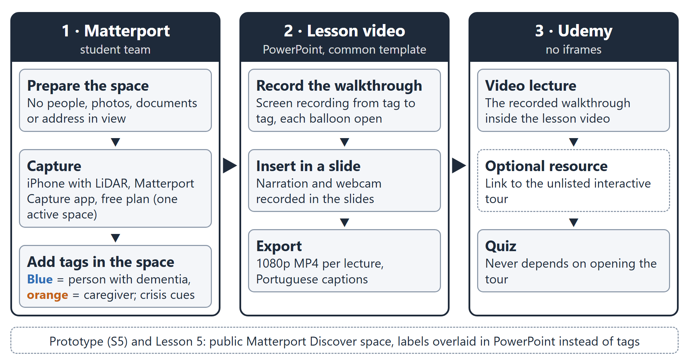
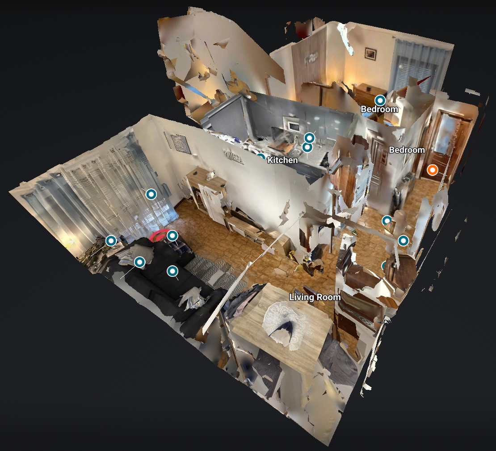
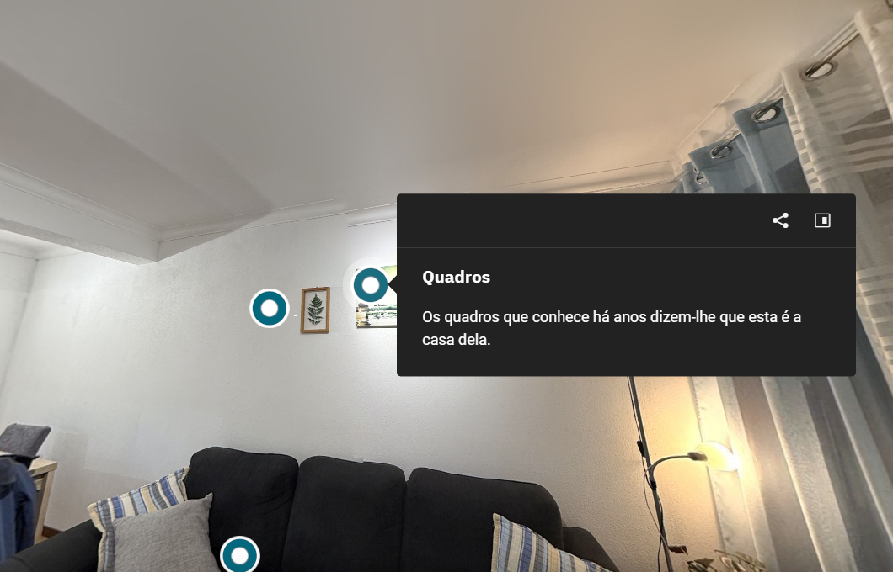
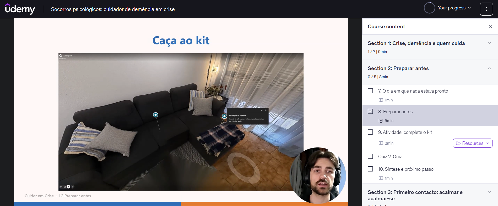

<!--
P2 — Fonte do artigo (inglês). O Word gera-se com: & .Artigo.ps1 (numa consola PowerShell, na pasta Files/P2) → P2_Artigo_Grupo1.docx + .pdf.
Formato: um parágrafo por linha · «%» título · «@» autor (4 linhas separadas por «|») · «Abstract—» e «Keywords—» · «#» Heading 1 · «##» Heading 2 ·
«###» Heading 3 · «» figura (a numeração «Fig. n.» é automática) · «[TABLE: título | texto]» tabela por fazer ·
«# References» e depois uma referência por linha (a numeração [n] é automática: a ordem tem de ser a da 1.ª citação no texto).

Estado (11/11): secções 1 e 2 em rascunho; 3–6 e o resumo depois do questionário (19/11).

A rever antes da versão final:
- [20] Blattgerste: confirmar que o kit usa a média de 68 e as escalas de adjetivos/percentis antes de citar para a interpretação do SUS.
- Fig. 1 e Fig. 5 são largas: na versão final ocupam as duas colunas (no topo de uma página); no rascunho ficam à largura de uma coluna.
- TABLE I entra quando chegarem as fichas Matterport (13/11).
- O DBR não tem referência própria: ou fica sem citação, ou entra uma de 2021+ (não inventar).
- Palavras: secções 1–2 ≈ 2400 (orçamento do plano: ≈ 2500 com a 2.3 incluída).
-->
% Student-Captured Matterport Tours in a Massive Open Online Course for Dementia Caregivers Facing Crises
@ Bruno Lopes | Instituto Superior de Engenharia do Porto (ISEP) | Porto, Portugal | 1240441@isep.ipp.pt
@ Tiago Teixeira | Instituto Superior de Engenharia do Porto (ISEP) | Porto, Portugal | 1240493@isep.ipp.pt
@ Rodrigo Silva | Instituto Superior de Engenharia do Porto (ISEP) | Porto, Portugal | 1221391@isep.ipp.pt
@ Ricardo Ferreira | Instituto Superior de Engenharia do Porto (ISEP) | Porto, Portugal | 1220901@isep.ipp.pt
@ Evandro Carvalho | Instituto Superior de Engenharia do Porto (ISEP) | Porto, Portugal | 1200929@isep.ipp.pt
Abstract—[To be written after the results: problem, method, N, main result, contribution; about 180 words, no acronyms or symbols.]
Keywords—Matterport, virtual tours, massive open online courses, dementia caregivers, psychological first aid, usability

# Introduction

Crises such as fires, floods, pandemics or forced displacement break the routines and spatial references that people with dementia rely on, and they put the relatives who care for them under sudden pressure. During the COVID-19 lockdowns, caregivers of people with dementia reported more depression, anxiety and burden [1]. A scoping review found that many informal caregivers do not feel prepared for disasters: they lack training, medication and supplies, and they find it hard to make decisions [2]. Online interventions can improve caregivers’ knowledge and reduce their depressive symptoms, anxiety and burden, although the evidence is still weak [3].

In a course unit on multimedia design, our team of five students built “Cuidar em Crise” (Caring in Crisis), a free course in European Portuguese that teaches caregivers how to prepare for a crisis and how to give psychological first aid to the person with dementia and to themselves. The course was published on Udemy in November 2026, with five lessons and 41 minutes of video. Massive open online courses (MOOCs) reach many people, but most learners leave early, and the attributes of the course are among the causes [4]. Short, interactive courses with frequent formative assessment tend to keep more learners [5], [6].

Each lesson had to include a Matterport space: a 3D capture of a real interior that learners can explore on a phone or a computer. The course is set in the fictional home of Mrs. Rosa, a woman with dementia, and her daughter Ana, who cares for her. The team captured its own homes with a smartphone and placed tags inside the spaces. However, Udemy does not accept embedded content (iframes), so the interactive tour could not be placed inside the lessons. This paper reports how the team worked around that limit and how users perceive the two formats that resulted: a recorded walkthrough inside the lesson video and an optional link to the interactive tour.

## Conceptual or Theoretical Framework

The design follows the cognitive theory of multimedia learning, which assumes two channels for words and pictures, a limited capacity in each channel, and active processing by the learner [7]. A recent meta-analysis of 181 studies found an overall effect of g = 0.37 for Mayer’s design principles. The largest effects came from removing distracting details (coherence), using spoken rather than written words (modality), a conversational style (personalization) and words with pictures (multimedia); signaling had a medium effect, and the effects changed with the type of media [8]. These principles shaped the lessons: one idea per short lecture, narration over images, and calm music kept low. Short, action-oriented content also suits adults with little time, and microlearning improves cognitive, behavioral and motivational outcomes [6]. The instructor’s face in a video brings small gains in retention, social presence and motivation, but it can draw attention away from the material, and its size matters [9].

For the spatial part, two lines of research are relevant. 360-degree video is mostly used to show environments, situations and demonstrations, but its research basis is still weak, and design guidelines are only emerging [10]. With middle-school students, immersive virtual reality gave more presence, interest and retention than a 2D video of the same virtual field trip, which supports an immersion principle [11]. Yet more spatial presence can also reduce learning, because it uses cognitive resources that are then not available for the content [12]. Screen-based and headset simulations have given comparable experiences [13], which supports non-immersive tours on a phone or a computer, as Matterport offers. In these terms, a recorded walkthrough is close to a guided video with low navigation effort, while the interactive tour adds learner control and presence at the cost of that effort.

## Related Research

MOOC research links completion to engagement and course design. A review of 21 studies described three phases of engagement and five groups of dropout factors, including the attributes of the course [4]. In 15 MOOCs, a learner-centric design that combined interactivity, formative assessment and discussion reached an average completion rate of 36% [5]. The type, length and purpose of a video shape how learners engage with it, and these patterns differ between a MOOC, a small private online course and a campus course [14].

Matterport has recently entered education. Nursing laboratories were captured with Matterport so that students could revisit them online; students reported high usability, satisfaction and engagement, and the authors present the tours as a complement to practice in the laboratory, not a replacement [15]. In vocational education, students learned to scan their laboratories with Matterport and to build augmented reality applications from them; that report presents the integration plan and first experiences, without an evaluation of learning [16]. A smartphone tour of a living museum, used with and without a headset, reached System Usability Scale (SUS) scores of 72.1 and 68.1, with no significant difference, and users with previous virtual reality experience gave higher scores [17].

Three gaps remain. Little is known about spaces captured by the students who author a course rather than by professionals; about closed course platforms that do not allow embedding; and about how a recorded walkthrough compares with the interactive tour of the same space for the same users. This case addresses all three.

## Study Objective

The objective is to describe and evaluate the integration of student-captured Matterport spaces in a MOOC hosted on a platform without embedding. Three research questions (RQ) guide the study.

RQ1 (development): What workflow, costs and constraints arise when a student team captures its own Matterport spaces and integrates them into a MOOC on a platform that does not allow embedding?

RQ2 (perception): How do users rate the usability and usefulness of the Matterport tour, and how does the recorded walkthrough compare with the interactive tour?

RQ3 (iteration): Which problems found in alpha and beta testing concerned the Matterport tours and the multimedia, and which design changes did they lead to?

# Method and Materials

## Research Model

The study is an exploratory case study within a design-based research approach, in which a design is built and revised in iterations in a real setting. The course was developed in eight weekly iterations, from 22 September to 10 November 2026; each one ended with a delivery and teacher feedback that fed into the next. The unit of analysis is the integration of Matterport in the course. The data combine design records (RQ1), a questionnaire (RQ2) and test records (RQ3), with quantitative and qualitative analysis.

## Methodology

Five undergraduate students, the authors, built the course, one lesson each, with a common template and visual model. The lessons follow the time line of a crisis: understanding it (L1), before (L2), during (L3 and L4) and after (L5). Every lesson follows the same pattern: a hook video, a content video with the Matterport walkthrough, an activity, a quiz with feedback, and a summary with a bridge to the next lesson (Fig. 1). From the fourth week, each student worked on their own lesson, with reviews across lessons. Two rounds of testing took place on 3 November 2026 with the course unit’s test sheet. In the alpha test, each author went through their own lesson, task by task. In the beta test, students from other teams tested our course, and we tested theirs. After publication, a short online questionnaire collected users’ perceptions of the tour (Section II-D).

## Development

### Lessons and video

Each lesson was scripted and then built as narrated PowerPoint slides with a common template: flat illustrations, blue for the person with dementia and orange for the caregiver, and the same background music. The slides were exported as Full HD video. After teacher feedback in the seventh week, every author recorded the narration again with the webcam on, in a small window in the same corner in all lessons. Lessons L1 to L3 have Portuguese captions written from the script. The course has 5 sections, 22 lectures, 5 quizzes and 41 minutes of video, about 8 minutes per lesson.

### Matterport capture

Fig. 2 summarizes the workflow. The homes of team members were prepared before capture, with no people, family photos, documents or address in view, and captured with the Matterport Capture app on a smartphone. Lessons L1 and L2 share one space, captured with an iPhone with a LiDAR sensor from 17 capture points. The free plan allows one active space per account, so the spaces were spread over the authors’ accounts and set as unlisted. Tags were added inside each space (Fig. 3): blue tags concern the person with dementia, orange tags concern the caregiver, and each title starts with the lesson (for example, “L2 - The kit”). Several tags name crisis situations, as the teacher asked in the third week. Lesson L5 kept the fallback of the prototype: a public space from Matterport Discover, captured by a third party, with five labels added over the video, because its author preferred not to publish a private space in a public course.

[TABLE: Matterport spaces per lesson | To be added after the capture forms from each author (13 November): space, device, capture points, capture time, time to add tags, number of tags, length of the walkthrough, main problem.]

### Integration without embedding

Because Udemy does not accept iframes, each tour enters the course in two ways. First, a screen recording of the walkthrough, moving from tag to tag with each balloon open, is part of the lesson video (Fig. 4 and Fig. 5). Second, a “3D tour (optional)” link is placed in the resources of the lecture. No quiz depends on the link, so learners with a slow connection or an old phone are not penalized. Udemy also requires at least 30 minutes of video to publish a free course and runs a quality review before publication: the course was submitted on 7 November and published on 9 November 2026.

## Data Collection Process

Six sources were used. D1, the design records: scripts, lesson structure, tags and durations. D2, a short form from each author about their capture: device, capture time, number of capture points, time to add the tags, problems and the reason for choosing the space. D3, the alpha and beta test records of 3 November. D4, the team’s Git history, with 116 commits from 10 October to 11 November. D5, the questionnaire. D6, the Udemy instructor analytics.

The questionnaire was built in Google Forms, in European Portuguese, and was open from 12 to 19 November 2026. It was anonymous, for adults only, and asked for consent on the first page. The sample is a convenience sample of relatives, friends, students of other programs and, where possible, caregivers, with a target of at least 25 answers; the authors did not answer. Participants first watched the narrated walkthrough of lesson L2 (1 min 40 s, taken from the lesson video) and rated four statements on a five-point scale: I understood the layout of the home; I understood where the risks and the emergency kit are; it held my attention; the length was appropriate. They then opened the interactive tour of the same space, searched for three named tags for up to 5 minutes, reported how many they found and how long it took, and rated the same four statements. The tour has a search menu that lists the tags, so a question also recorded how participants reached them: by walking, through the dollhouse view or floor plan, or through the search. Next, they answered the SUS about the interactive tour, in its validated European Portuguese version, in which the items refer to the “product”, here the 3D tour [18]. Finally, they chose the format they prefer and answered two open questions: what helped them understand the home, and what was hardest. A profile block recorded the age band, caregiving experience, previous use of 3D tours and the device. No person with dementia took part in any stage, and the home and its residents are fictional.

## Data Analysis

SUS scores were computed on the 0–100 scale with Brooke’s formula [19]: odd items score the answer minus one, even items five minus the answer, and the sum is multiplied by 2.5. We report the mean and standard deviation and compare them with published interpretation scales [20]. The ratings of the video and of the interactive tour were compared, for each statement, with the Wilcoxon signed-rank test for paired samples (normal approximation with corrections for ties and continuity) and the effect size r = |z|/√n. Respondents who did not watch the whole video were left out of this comparison, and with fewer than 20 valid answers only descriptive statistics are reported. For the search task, we report the share of participants who found all three tags, by device. The open answers and the test notes (D3) went through a thematic analysis with seven fixed categories: navigation, finding tags, understanding the space, performance and device, audio and video, assessment, and other. The answers were first split into units with one idea each; two authors then coded every unit independently, and agreement is reported as a percentage and as Cohen’s kappa, with disagreements resolved by discussion. For RQ1, the lessons are compared in Table I, and the effort per iteration comes from the Git history (D4). All computations were run with a small script, checked against cases with known results.

# Results

[To be written after the questionnaire closes on 19 November: RQ1 (Table I, effort per iteration), RQ2 (Fig. 6, Fig. 7, Table III), RQ3 (Table II).]

# Discussion

[To be written after the results.]

# Conclusion

[To be written after the results, including the limitations.]

# Future Work

[To be written after the results.]

# References

P. Soysal et al., “The impact of the COVID-19 pandemic on the psychological well-being of caregivers of people with dementia or mild cognitive impairment: A systematic review and meta-analysis,” Geriatrics, vol. 8, no. 5, Art. no. 97, Sep. 2023, doi: 10.3390/geriatrics8050097.
C. J. Pickering, M. Dancey, K. Paik, and T. O’Sullivan, “Informal caregiving and disaster risk reduction: A scoping review,” Int. J. Disaster Risk Sci., vol. 12, no. 2, pp. 169–187, Apr. 2021, doi: 10.1007/s13753-021-00328-8.
L. K. Bui, M. Park, and T. T. T. Giap, “eHealth interventions for the informal caregivers of people with dementia: A systematic review of systematic reviews,” Geriatr. Nurs., vol. 48, pp. 203–213, Nov. 2022, doi: 10.1016/j.gerinurse.2022.09.015.
H. Huang, L. Jew, and D. Qi, “Take a MOOC and then drop: A systematic review of MOOC engagement pattern and dropout factor,” Heliyon, vol. 9, no. 4, Art. no. e15220, Apr. 2023, doi: 10.1016/j.heliyon.2023.e15220.
V. Shah, S. Murthy, J. Warriem, S. Sahasrabudhe, G. Banerjee, and S. Iyer, “Learner-centric MOOC model: A pedagogical design model towards active learner participation and higher completion rates,” Educ. Technol. Res. Dev., vol. 70, no. 1, pp. 263–288, Feb. 2022, doi: 10.1007/s11423-022-10081-4.
W. K. Monib, A. Qazi, and R. A. Apong, “Microlearning beyond boundaries: A systematic review and a novel framework for improving learning outcomes,” Heliyon, vol. 11, no. 2, Art. no. e41413, Jan. 2025, doi: 10.1016/j.heliyon.2024.e41413.
R. E. Mayer, “The past, present, and future of the cognitive theory of multimedia learning,” Educ. Psychol. Rev., vol. 36, no. 1, Art. no. 8, Mar. 2024, doi: 10.1007/s10648-023-09842-1.
J. G. Cromley and R. Chen, “A meta-analysis of Richard Mayer’s multimedia learning research: Searching for boundary conditions of design principles across multiple media types,” Educ. Res. Rev., vol. 49, Art. no. 100730, Nov. 2025, doi: 10.1016/j.edurev.2025.100730.
M. Beege, N. L. Schroeder, S. Heidig, G. D. Rey, and S. Schneider, “The instructor presence effect and its moderators in instructional video: A series of meta-analyses,” Educ. Res. Rev., vol. 41, Art. no. 100564, Nov. 2023, doi: 10.1016/j.edurev.2023.100564.
M. Evens, M. Empsen, and W. Hustinx, “A literature review on 360-degree video as an educational tool: Towards design guidelines,” J. Comput. Educ., vol. 10, no. 2, pp. 325–375, Jun. 2023, doi: 10.1007/s40692-022-00233-z.
G. Makransky and R. E. Mayer, “Benefits of taking a virtual field trip in immersive virtual reality: Evidence for the immersion principle in multimedia learning,” Educ. Psychol. Rev., vol. 34, no. 3, pp. 1771–1798, Sep. 2022, doi: 10.1007/s10648-022-09675-4.
S. J. Ahn, K. L. Nowak, and J. N. Bailenson, “Unintended consequences of spatial presence on learning in virtual reality,” Comput. Educ., vol. 186, Art. no. 104532, Sep. 2022, doi: 10.1016/j.compedu.2022.104532.
S. Azher, A. Cervantes, C. Marchionni, K. Grewal, H. Marchand, and J. M. Harley, “Virtual simulation in nursing education: Headset virtual reality and screen-based virtual simulation offer a comparable experience,” Clin. Simul. Nurs., vol. 79, pp. 61–74, Jun. 2023, doi: 10.1016/j.ecns.2023.02.009.
M. Khalil, P. Topali, A. Ortega-Arranz, E. Er, G. Akçapınar, and G. Belokrys, “Video analytics in digital learning environments: Exploring student behaviour across different learning contexts,” Technol. Knowl. Learn., vol. 29, no. 4, pp. 1877–1905, Dec. 2024, doi: 10.1007/s10758-023-09680-8.
J. Potter, K. Theobald, and S. Johnston, “Virtual learning with Matterport: A novel approach to teaching psychomotor skills in nursing,” Clin. Simul. Nurs., vol. 110, Art. no. 101871, Jan. 2026, doi: 10.1016/j.ecns.2025.101871.
D. Kiriakos, D. Kotsifakos, and Y. Psaromiligkos, “A leveraging Matterport for industry-focused mobile applications: Augmented reality training for vocational education and training,” in Proc. 8th South-East Eur. Design Autom., Comput. Eng., Comput. Netw. Social Media Conf. (SEEDA-CECNSM), Nov. 2023, pp. 1–7, doi: 10.1109/SEEDA-CECNSM61561.2023.10470495.
M. K. Othman, A. Nogoibaeva, L. S. Leong, and M. H. Barawi, “Usability evaluation of a virtual reality smartphone app for a living museum,” Univ. Access Inf. Soc., vol. 21, no. 4, pp. 995–1012, Nov. 2022, doi: 10.1007/s10209-021-00820-4.
A. I. Martins, A. F. Rosa, A. Queirós, A. Silva, and N. P. Rocha, “European Portuguese validation of the System Usability Scale (SUS),” Procedia Comput. Sci., vol. 67, pp. 293–300, 2015, doi: 10.1016/j.procs.2015.09.273.
J. Brooke, “SUS: A ‘quick and dirty’ usability scale,” in Usability Evaluation in Industry, P. W. Jordan, B. Thomas, I. L. McClelland, and B. Weerdmeester, Eds. CRC Press, 1996, pp. 207–212, doi: 10.1201/9781498710411-35.
J. Blattgerste, J. Behrends, and T. Pfeiffer, “A web-based analysis toolkit for the System Usability Scale,” in Proc. 15th Int. Conf. PErvasive Technol. Related Assistive Environ. (PETRA), Jun. 2022, pp. 237–246, doi: 10.1145/3529190.3529216.
