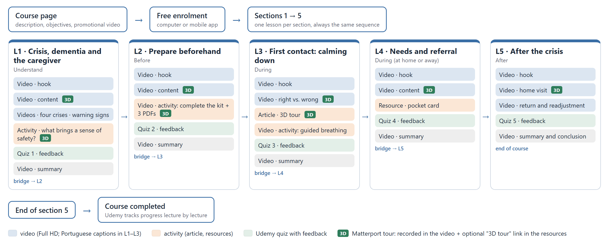
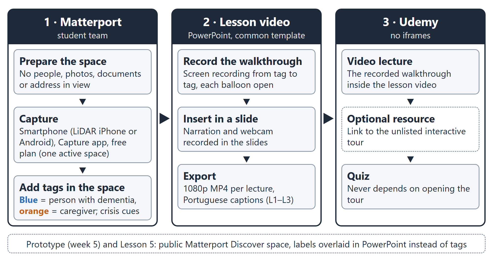
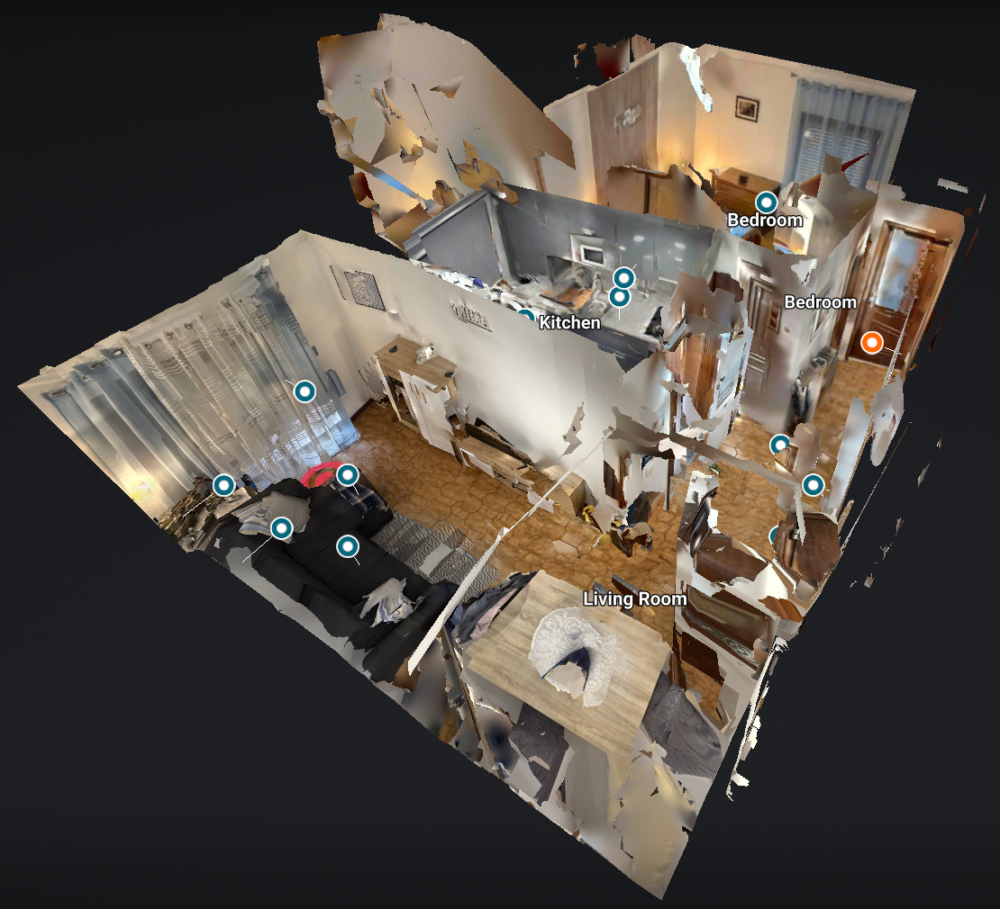
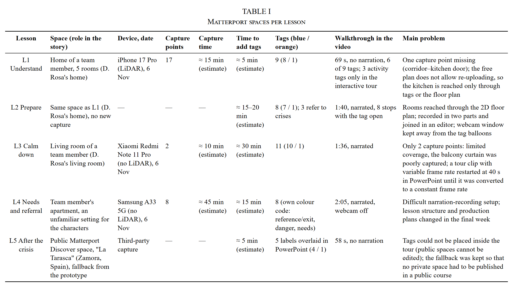
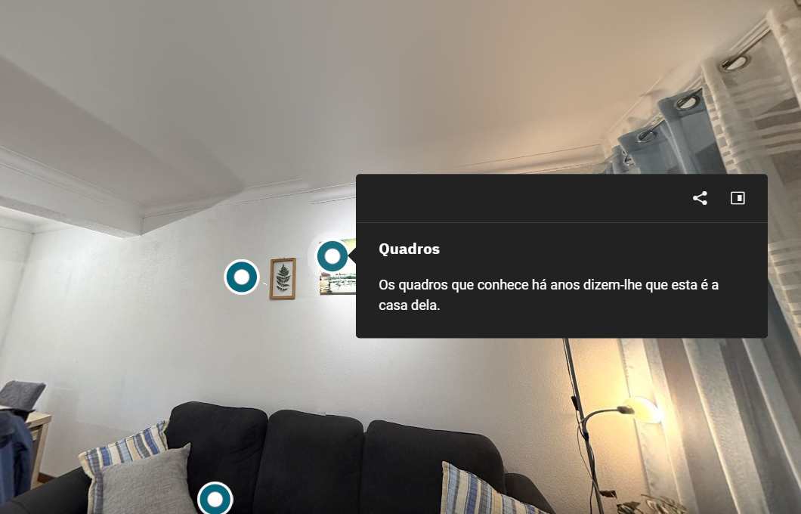
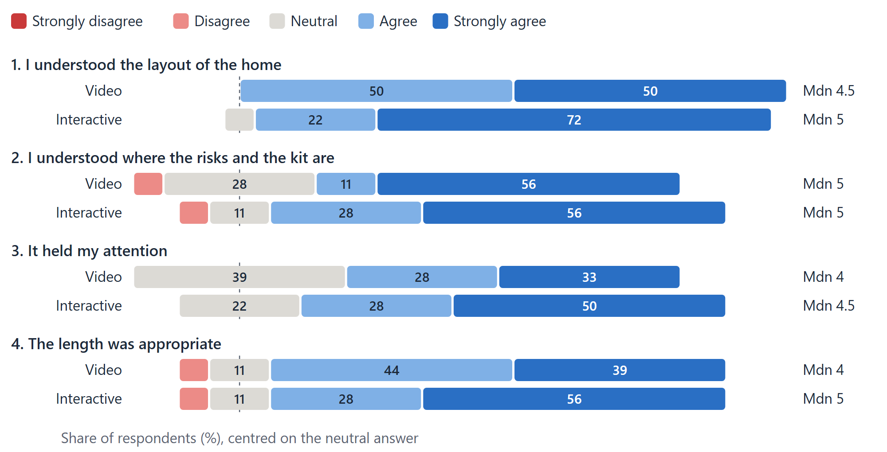
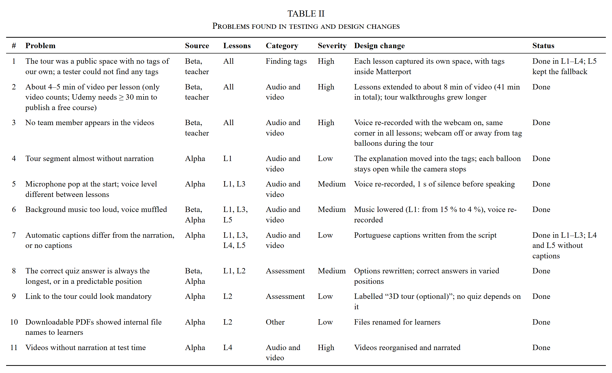

<!--
P2 — Fonte do artigo (inglês). O Word gera-se com: & .Artigo.ps1 (numa consola PowerShell, na pasta Files/P2) → P2_Artigo_Grupo1.docx + .pdf.
Formato: um parágrafo por linha · «%» título · «@» autor (4 linhas separadas por «|») · «Abstract—» e «Keywords—» · «#» Heading 1 · «##» Heading 2 ·
«###» Heading 3 · «» figura (a numeração «Fig. n.» é automática) · «[TABLE: título | texto]» tabela por fazer ·
«# References» e depois uma referência por linha (a numeração [n] é automática: a ordem tem de ser a da 1.ª citação no texto).

Estado (19/11): secções 1 e 2 entregues a 18/11; secção 3 (Results) escrita a 19/11 com as 20 respostas (`Dados/Resultados.md`), falta a concordância dos dois codificadores; 4 (Ricardo), 5 (Evandro) e 6 (Rodrigo) até sáb 21/11. A Tabela III saiu (os valores estão no texto e na Fig. 5), para caber em 6 páginas.
«» insere a tabela já exportada (a imagem traz o «TABLE n»), sem legenda «Fig.» · «{wide}» no fim de uma figura ou tabela → ocupa as duas colunas (quebras de secção contínuas).

A rever antes da versão final:
- [19] Blattgerste: lido a 19/11 (PDF da ACM). Não fala em 68: diz que a média do SUS é ≈ 70 (Bangor et al.) e descreve as escalas de adjetivos, notas, quartis, aceitabilidade (> 70 aceitável, < 50 não aceitável) e a curva de percentis. O artigo passou de «68» para «cerca de 70» e para a escala de aceitabilidade.
- TABLE I: ficha da L4 recebida a 16/11; regenerar a tabela e o artigo após alterações a `P2_Tabelas.md`.
- L4: a ficha diz 8 tags, o `P1/L4/Guiao_L4.md` (secção 4) e o relatório do S8 dizem 7. A Tabela I segue a ficha (8): o Ricardo confirma no espaço Matterport e, se forem 7, corrige o guião ou o `P2_Tabelas.md` (→ `node Figuras/Tabelas.js 1` → `& .\Artigo.ps1`).
- 17/11: resumo e introdução já não dizem que todas as visitas são casas capturadas pelo grupo (a L5 é do Discover); frase do «n/r» retirada (a Tabela I já não tem «n/r»); o código de cores próprio da L4 está na 2.3; saiu a frase das estimativas da L4 (estão na Tabela I).
- ⚠ Espaço: as referências contam para as 6 páginas (professora, 17/11). Corte de 17/11: saiu a figura da tag aberta, a aula na Udemy é a Fig. 4 numa coluna, secções 1–2 com ≈ 500 palavras a menos; os resultados começam no fim da 1.ª coluna da pág. 4. Ficam ≈ 1,75 páginas para as secções 3–6, Figuras 5–6 (numa coluna) e Tabelas II–III: Discussão ≈ 350 palavras.
- Brooke 1996 saiu a 16/11 e o Martins 2015 (validação portuguesa do SUS) a 17/11: só referências de 2021–2026. 19 referências.
- DBR: citado em [18] (Tinoca et al. 2022, MDPI), acrescentado a 16/11.
- Palavras: secções 1–2 ≈ 2400 (orçamento do plano: ≈ 2500 com a 2.3 incluída).
-->
% Student-Captured Matterport Tours in a Massive Open Online Course for Dementia Caregivers Facing Crises
@ Bruno Lopes | Instituto Superior de Engenharia do Porto (ISEP) | Porto, Portugal | 1240441@isep.ipp.pt
@ Tiago Teixeira | Instituto Superior de Engenharia do Porto (ISEP) | Porto, Portugal | 1240493@isep.ipp.pt
@ Rodrigo Silva | Instituto Superior de Engenharia do Porto (ISEP) | Porto, Portugal | 1221391@isep.ipp.pt
@ Ricardo Ferreira | Instituto Superior de Engenharia do Porto (ISEP) | Porto, Portugal | 1220901@isep.ipp.pt
@ Evandro Carvalho | Instituto Superior de Engenharia do Porto (ISEP) | Porto, Portugal | 1200929@isep.ipp.pt
Abstract—Crises such as fires, floods or forced displacement disrupt the routines of people with dementia and overload the relatives who care for them. A team of five students built a free course in European Portuguese on psychological first aid for these caregivers and published it on Udemy, with five lessons and 41 minutes of video. Each lesson includes a Matterport tour; in four lessons it shows a home captured by the students, with tags for the person with dementia and for the caregiver. As the platform does not accept embedded content, each tour entered the course as a recorded walkthrough in the lesson video and as an optional link to the interactive tour. This exploratory case study, framed as design-based research, describes the capture and integration workflow and the changes that followed alpha and beta testing, and compares the recorded walkthrough with the interactive tour through a questionnaire that includes the System Usability Scale. Twenty users gave the interactive tour a mean System Usability Scale score of 77.3, and 75% found three named tags in it; they rated the interactive tour equal to or higher than the walkthrough, and none preferred the video alone.
Keywords—Matterport, virtual tours, massive open online courses, dementia caregivers, psychological first aid, usability

# Introduction

Crises such as fires, floods, pandemics or forced displacement break the routines and spatial references that people with dementia rely on and put their caregivers under sudden pressure. During the COVID-19 lockdowns, caregivers of people with dementia reported more depression, anxiety and burden [1]. Many informal caregivers do not feel prepared for disasters: they lack training, medication and supplies, and find it hard to make decisions [2]. Online interventions can improve caregivers’ knowledge and reduce depressive symptoms, anxiety and burden, although the evidence is still weak [3].

In a course unit on multimedia design, our team of five students built “Cuidar em Crise” (Caring in Crisis), a free course in European Portuguese that teaches caregivers to prepare for a crisis and to give psychological first aid to the person with dementia and to themselves. It was published on Udemy in November 2026. Most learners leave massive open online courses (MOOCs) early, partly because of the attributes of the course [4], while short, interactive courses with frequent formative assessment keep more learners [5], [6].

Each lesson had to include a Matterport space, a 3D capture of a real interior that can be explored on a phone or a computer. The course is set in the fictional home of Mrs. Rosa, who has dementia, and her daughter and caregiver Ana. For four lessons, the team captured its own homes with a smartphone and placed tags inside the spaces. However, Udemy does not accept embedded content (iframes). This paper reports how the team worked around that limit and how users perceive the two resulting formats: a recorded walkthrough inside the lesson video and an optional link to the interactive tour.

## Conceptual or Theoretical Framework

The design follows the cognitive theory of multimedia learning: two channels for words and pictures, a limited capacity in each, and active processing by the learner [7]. A meta-analysis of 181 studies found an overall effect of g = 0.37 for Mayer’s principles, largest for coherence, modality, personalization and multimedia, with effects that changed with the type of media [8]. These principles shaped the lessons: one idea per short lecture, narration over images, and low background music. The instructor’s face brings small gains in retention, social presence and motivation, but it can distract, and its size matters [9].

For the spatial part, 360-degree video is mostly used to show environments and demonstrations, but its research basis is still weak [10]. Immersive virtual reality gave more presence, interest and retention than a 2D video of the same field trip [11], yet more spatial presence can also reduce learning, by taking cognitive resources away from the content [12]. Screen-based and headset simulations have given comparable experiences [13], which supports non-immersive tours such as Matterport’s. In these terms, a recorded walkthrough is a guided video with low navigation effort, while the interactive tour adds learner control and presence at the cost of that effort.

## Related Research

In 15 MOOCs, a learner-centric design with interactivity, formative assessment and discussion reached an average completion rate of 36% [5]. The type, length and purpose of a video shape how learners engage with it, and these patterns differ between MOOCs and campus courses [14].

Matterport has recently entered education. Nursing students who revisited Matterport captures of their laboratories online reported high usability, satisfaction and engagement; the authors present the tours as a complement to practice, not a replacement [15]. In vocational education, students scanned their laboratories with Matterport to build augmented reality applications, without an evaluation of learning [16]. A smartphone tour of a living museum, with and without a headset, reached System Usability Scale (SUS) scores of 72.1 and 68.1, with no significant difference, and users with previous virtual reality experience gave higher scores [17].

Three gaps remain: spaces captured by the students who author a course rather than by professionals; closed platforms that do not allow embedding; and how a recorded walkthrough compares with the interactive tour of the same space for the same users.

## Study Objective

The objective is to describe and evaluate the integration of student-captured Matterport spaces in a MOOC on a platform without embedding, through three research questions (RQ).

RQ1 (development): What workflow, costs and constraints arise when a student team captures its own Matterport spaces and brings them into such a course?

RQ2 (perception): How do users rate the usability and usefulness of the Matterport tour, and how does the recorded walkthrough compare with the interactive tour?

RQ3 (iteration): Which problems found in alpha and beta testing concerned the Matterport tours and the multimedia, and which design changes did they lead to?

# Method and Materials

## Research Model

The study is an exploratory case study within design-based research, in which a design is built and revised in iterative cycles in a real setting [18]. The course was developed in eight weekly iterations, from 22 September to 10 November 2026, each ending with a delivery and teacher feedback. The data combine design records (RQ1), a questionnaire (RQ2) and test records (RQ3).

## Methodology

The five authors, undergraduate students, built one lesson each. The lessons follow the time line of a crisis: understanding it (L1), before (L2), during (L3 and L4) and after (L5). Each lesson has a hook video, a content video with the Matterport walkthrough, an activity, a quiz with feedback, and a summary with a bridge to the next lesson (Fig. 1). Two rounds of testing took place on 3 November 2026 with the course unit’s test sheet: in the alpha test, each author went through their own lesson, task by task; in the beta test, students from other teams tested our course. After publication, an online questionnaire collected users’ perceptions of the tour (Section II-D).

{wide}

## Development

### Lessons and video

Each lesson was scripted and built as narrated PowerPoint slides with a common template (flat illustrations, blue for the person with dementia, orange for the caregiver, the same music) and exported as Full HD video. After teacher feedback in the seventh week, every author recorded the narration again with a small webcam window in the same corner. Lessons L1 to L3 have Portuguese captions. The course has 5 sections, 22 lectures, 5 quizzes and 41 minutes of video.

### Matterport capture

Fig. 2 summarizes the workflow. Team members’ homes were captured with the Matterport Capture app on a smartphone, with no people, family photos, documents or address in view. Lessons L1 and L2 share one space, captured with a LiDAR iPhone from 17 points. L3 used a phone without LiDAR and only two points, which left parts of the living room poorly captured. L4 used another member’s apartment as an unfamiliar setting, captured with a Samsung A33 5G from eight points. The free plan allows one active space per account, so the spaces were spread over the authors’ accounts and set as unlisted. Tags were added inside each space (Fig. 3): blue for the person with dementia, orange for the caregiver, each title starting with the lesson (e.g., “L2 - The kit”); L4 used its own colour code, by type of place. L5 kept the fallback of the prototype, a public Matterport Discover space with five labels over the video, because its author preferred not to publish a private space. Table I compares the spaces.

{wide}

### Integration without embedding

Because Udemy does not accept iframes, each tour enters the course in two ways. First, a screen recording of the walkthrough, moving from tag to tag with each balloon open, is part of the lesson video (Fig. 4). Such recordings have a variable frame rate, and in L3 PowerPoint restarted one clip after 40 s until it was converted to a constant frame rate. Second, a “3D tour (optional)” link is placed in the lecture resources; no quiz depends on it, so learners with a slow connection or an old phone are not penalized. Udemy requires at least 30 minutes of video for a free course and reviews its quality before publication: the course was submitted on 7 November and published on 9 November 2026.

## Data Collection Process

Six sources were used: D1, the design records (scripts, structure, tags, durations); D2, a short form from each author about their capture (device, capture time, capture points, time to add the tags, problems, choice of space); D3, the alpha and beta test records; D4, the team’s Git history (116 commits, 10 October to 11 November); D5, the questionnaire; D6, the Udemy instructor analytics.

The questionnaire was built in Google Forms, in European Portuguese, and was open from 12 to 19 November 2026. It was anonymous, for adults only, with consent on the first page. The convenience sample covers relatives, friends, students of other programs and, where possible, caregivers, with a minimum of 20 answers; the authors did not answer. Participants first watched the narrated walkthrough of lesson L2 (1 min 40 s) and rated four statements on a five-point scale: I understood the layout of the home; I understood where the risks and the emergency kit are; it held my attention; the length was appropriate. They then opened the interactive tour of the same space, searched for three named tags for up to 5 minutes, reported how many they found, how long it took and how they reached them (walking, dollhouse view or floor plan, or the search menu that lists the tags), and rated the same statements. Next, they answered the SUS about the interactive tour, in European Portuguese, with “product” read as the 3D tour. Finally, they chose the format they prefer and answered two open questions: what helped them understand the home, and what was hardest. A profile block recorded the age band, caregiving experience, previous use of 3D tours and the device. No person with dementia took part.

## Data Analysis

SUS scores were computed on the usual 0–100 scale, reported as mean and standard deviation, and read against the scales summarised in [19]: an average of about 70, with scores above 70 counted as acceptable and below 50 as not acceptable. For each statement, the ratings of the video and of the interactive tour were compared with the Wilcoxon signed-rank test for paired samples, with the effect size r = |z|/√n; respondents who did not watch the whole video were left out, and with fewer than 20 valid answers only descriptive statistics are reported. For the search task, we report the share who found all three tags, by device. The answers on what was hardest and the test notes (D3) went through a thematic analysis with seven fixed categories: navigation, finding tags, understanding the space, performance and device, audio and video, assessment, and other. Two authors coded every unit of meaning independently; agreement is reported as a percentage and as Cohen’s kappa, with disagreements resolved by discussion. The answers on what helped, which mostly name a format, were counted by format. For RQ1, the lessons are compared in Table I, and the effort per iteration comes from D4.

# Results

## Development (RQ1)

Capturing a space took between about 10 and 45 minutes and adding the tags between 5 and 30 minutes (authors’ estimates, Table I). The whole workflow used free tools: the free Matterport plan, PowerPoint for the videos and a free Udemy course. The constraints came from the plan and the devices: one active space per account, no new upload to fix a missing capture point (L1), fewer capture points and poorer coverage with phones without LiDAR (L3, L4), and public Discover spaces that cannot be edited (L5). Of the 79 commits on the course, 21 fell in the prototype iteration and 31 in the final one, against 6 to 14 in the others: most captures and all webcam re-recordings happened in the last week, after the teacher’s feedback in the seventh.

## Perception (RQ2)

Twenty people answered the questionnaire, 12 on a phone and 8 on a computer; 12 were 25 to 34 years old, 5 had been caregivers and 9 had never used a 3D tour. The 18 of them who watched the whole video rated the interactive tour equal to or higher than the walkthrough on all four statements (Fig. 5). Only “it held my attention” differed significantly (median 4 vs. 4.5; p = .048, r = .89), and only 5 respondents changed that rating; for the other statements, p ≥ .30. No respondent preferred the video alone: 10 chose the interactive tour and 10 both formats.

The interactive tour reached a mean SUS score of 77.3 (SD 13.9; median 80; range 47.5–100), above the average of about 70 summarised in [19]: 14 of the 20 scores were acceptable (above 70), 5 marginal (50–70) and 1 below 50 (Fig. 6). The mean was 79.1 on a computer and 76.0 on a phone.

![SUS scores of the interactive tour, one dot per respondent (N = 20); the dashed line marks the average of about 70 summarised in [19].](Figuras/Figura6.png)

Fifteen respondents (75%) found the three tags: 7 of 8 on a computer and 8 of 12 on a phone. Eleven needed less than 2 minutes, 8 between 2 and 5, and one more than 5 minutes or stopped. To reach them, 16 walked through the home, 12 used the dollhouse view or the floor plan and 3 the search menu (more than one answer allowed).

Of the 14 answers on what helped to understand the home, 9 named the interactive tour (two of them the freedom to move around and one the dollhouse view), 4 the video or its narration, and 1 both. Two authors coded the 10 difficulties and the 12 test problems independently and agreed on 21 of the 22 units (95.5%, Cohen’s kappa 0.93); the one disagreement was resolved by discussion. Half of the difficulties concerned navigation, mostly moving between rooms in the tour without the dollhouse view (5), followed by audio and video, namely keeping attention on the video (3), finding tags (1), and performance and device (1); 4 respondents found nothing difficult.

## Iteration (RQ3)

The alpha and beta tests raised 11 problems (Table II). Their 12 units were coded as audio and video (8), assessment (2), finding tags (1) and other (1). Three problems concerned the Matterport tours: a public space with no tags of our own, in which a tester found no tags; a walkthrough almost without narration; and a link that could look mandatory. The three most severe came from the beta test and the teacher and changed every lesson: each author captured a space with tags inside it, the lessons grew to about 8 minutes of video, and the narration was re-recorded with the webcam on. Nine problems were solved in every lesson they affected and two in part: L5 kept the Discover space, and L4 and L5 have no captions.

{wide}

# Discussion

[To be written after the results.]

# Conclusion

[To be written after the results, including the limitations.]

# Future Work

[To be written after the results.]

# References

P. Soysal et al., “The impact of the COVID-19 pandemic on the psychological well-being of caregivers of people with dementia or mild cognitive impairment: A systematic review and meta-analysis,” Geriatrics, vol. 8, no. 5, Art. no. 97, Sep. 2023, doi: 10.3390/geriatrics8050097.
C. J. Pickering, M. Dancey, K. Paik, and T. O’Sullivan, “Informal caregiving and disaster risk reduction: A scoping review,” Int. J. Disaster Risk Sci., vol. 12, no. 2, pp. 169–187, Apr. 2021, doi: 10.1007/s13753-021-00328-8.
L. K. Bui, M. Park, and T. T. T. Giap, “eHealth interventions for the informal caregivers of people with dementia: A systematic review of systematic reviews,” Geriatr. Nurs., vol. 48, pp. 203–213, Nov. 2022, doi: 10.1016/j.gerinurse.2022.09.015.
H. Huang, L. Jew, and D. Qi, “Take a MOOC and then drop: A systematic review of MOOC engagement pattern and dropout factor,” Heliyon, vol. 9, no. 4, Art. no. e15220, Apr. 2023, doi: 10.1016/j.heliyon.2023.e15220.
V. Shah, S. Murthy, J. Warriem, S. Sahasrabudhe, G. Banerjee, and S. Iyer, “Learner-centric MOOC model: A pedagogical design model towards active learner participation and higher completion rates,” Educ. Technol. Res. Dev., vol. 70, no. 1, pp. 263–288, Feb. 2022, doi: 10.1007/s11423-022-10081-4.
W. K. Monib, A. Qazi, and R. A. Apong, “Microlearning beyond boundaries: A systematic review and a novel framework for improving learning outcomes,” Heliyon, vol. 11, no. 2, Art. no. e41413, Jan. 2025, doi: 10.1016/j.heliyon.2024.e41413.
R. E. Mayer, “The past, present, and future of the cognitive theory of multimedia learning,” Educ. Psychol. Rev., vol. 36, no. 1, Art. no. 8, Mar. 2024, doi: 10.1007/s10648-023-09842-1.
J. G. Cromley and R. Chen, “A meta-analysis of Richard Mayer’s multimedia learning research: Searching for boundary conditions of design principles across multiple media types,” Educ. Res. Rev., vol. 49, Art. no. 100730, Nov. 2025, doi: 10.1016/j.edurev.2025.100730.
M. Beege, N. L. Schroeder, S. Heidig, G. D. Rey, and S. Schneider, “The instructor presence effect and its moderators in instructional video: A series of meta-analyses,” Educ. Res. Rev., vol. 41, Art. no. 100564, Nov. 2023, doi: 10.1016/j.edurev.2023.100564.
M. Evens, M. Empsen, and W. Hustinx, “A literature review on 360-degree video as an educational tool: Towards design guidelines,” J. Comput. Educ., vol. 10, no. 2, pp. 325–375, Jun. 2023, doi: 10.1007/s40692-022-00233-z.
G. Makransky and R. E. Mayer, “Benefits of taking a virtual field trip in immersive virtual reality: Evidence for the immersion principle in multimedia learning,” Educ. Psychol. Rev., vol. 34, no. 3, pp. 1771–1798, Sep. 2022, doi: 10.1007/s10648-022-09675-4.
S. J. Ahn, K. L. Nowak, and J. N. Bailenson, “Unintended consequences of spatial presence on learning in virtual reality,” Comput. Educ., vol. 186, Art. no. 104532, Sep. 2022, doi: 10.1016/j.compedu.2022.104532.
S. Azher, A. Cervantes, C. Marchionni, K. Grewal, H. Marchand, and J. M. Harley, “Virtual simulation in nursing education: Headset virtual reality and screen-based virtual simulation offer a comparable experience,” Clin. Simul. Nurs., vol. 79, pp. 61–74, Jun. 2023, doi: 10.1016/j.ecns.2023.02.009.
M. Khalil, P. Topali, A. Ortega-Arranz, E. Er, G. Akçapınar, and G. Belokrys, “Video analytics in digital learning environments: Exploring student behaviour across different learning contexts,” Technol. Knowl. Learn., vol. 29, no. 4, pp. 1877–1905, Dec. 2024, doi: 10.1007/s10758-023-09680-8.
J. Potter, K. Theobald, and S. Johnston, “Virtual learning with Matterport: A novel approach to teaching psychomotor skills in nursing,” Clin. Simul. Nurs., vol. 110, Art. no. 101871, Jan. 2026, doi: 10.1016/j.ecns.2025.101871.
D. Kiriakos, D. Kotsifakos, and Y. Psaromiligkos, “A leveraging Matterport for industry-focused mobile applications: Augmented reality training for vocational education and training,” in Proc. 8th South-East Eur. Design Autom., Comput. Eng., Comput. Netw. Social Media Conf. (SEEDA-CECNSM), Nov. 2023, pp. 1–7, doi: 10.1109/SEEDA-CECNSM61561.2023.10470495.
M. K. Othman, A. Nogoibaeva, L. S. Leong, and M. H. Barawi, “Usability evaluation of a virtual reality smartphone app for a living museum,” Univ. Access Inf. Soc., vol. 21, no. 4, pp. 995–1012, Nov. 2022, doi: 10.1007/s10209-021-00820-4.
L. Tinoca, J. Piedade, S. Santos, A. Pedro, and S. Gomes, “Design-based research in the educational field: A systematic literature review,” Educ. Sci., vol. 12, no. 6, Art. no. 410, Jun. 2022, doi: 10.3390/educsci12060410.
J. Blattgerste, J. Behrends, and T. Pfeiffer, “A web-based analysis toolkit for the System Usability Scale,” in Proc. 15th Int. Conf. PErvasive Technol. Related Assistive Environ. (PETRA), Jun. 2022, pp. 237–246, doi: 10.1145/3529190.3529216.
