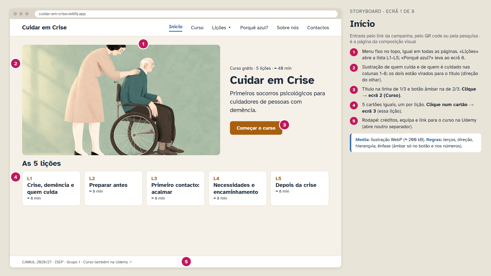
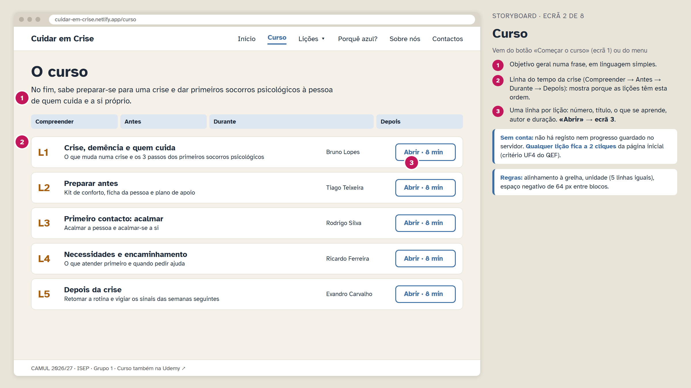
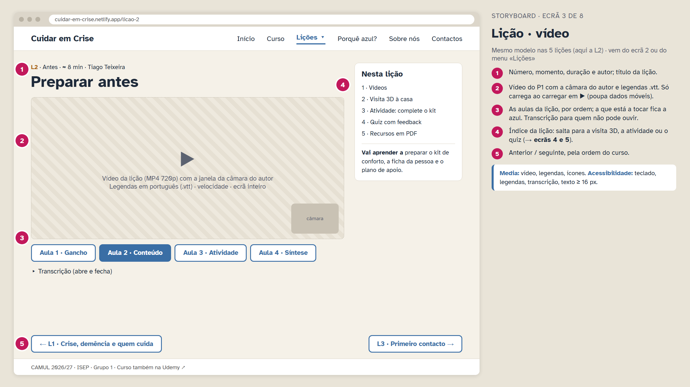
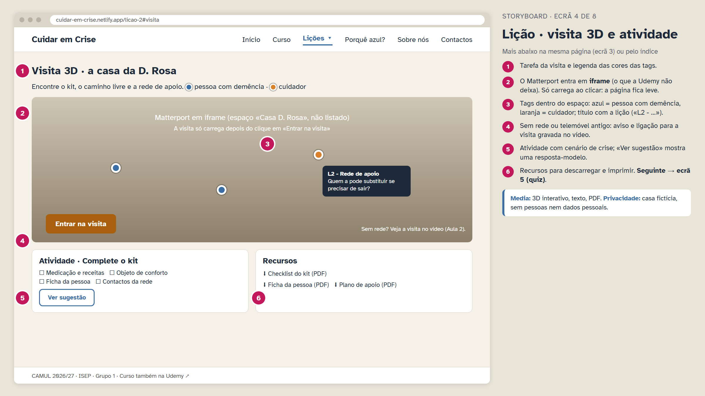
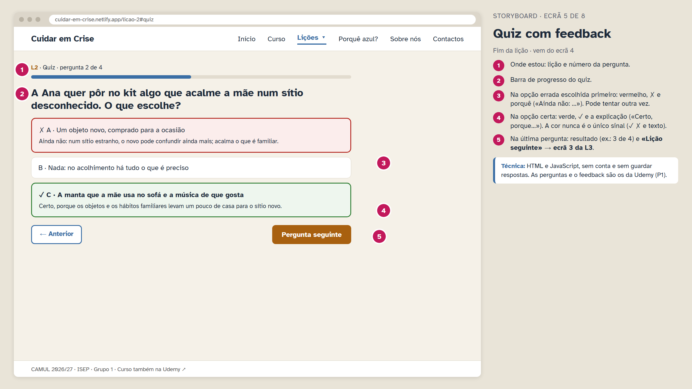
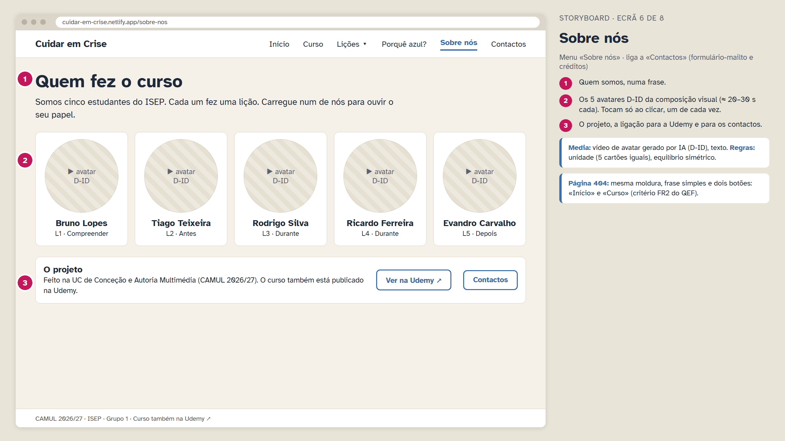
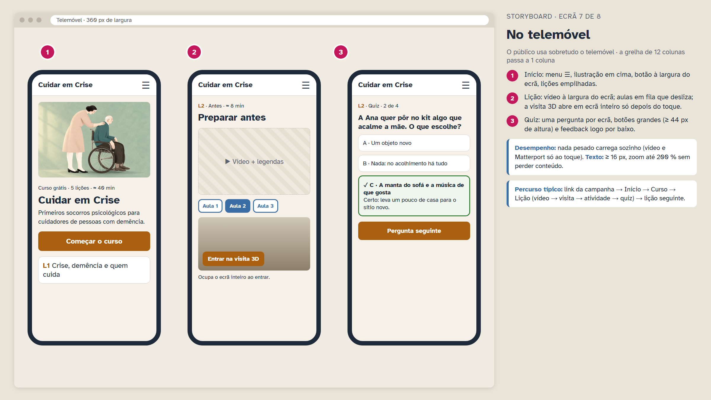
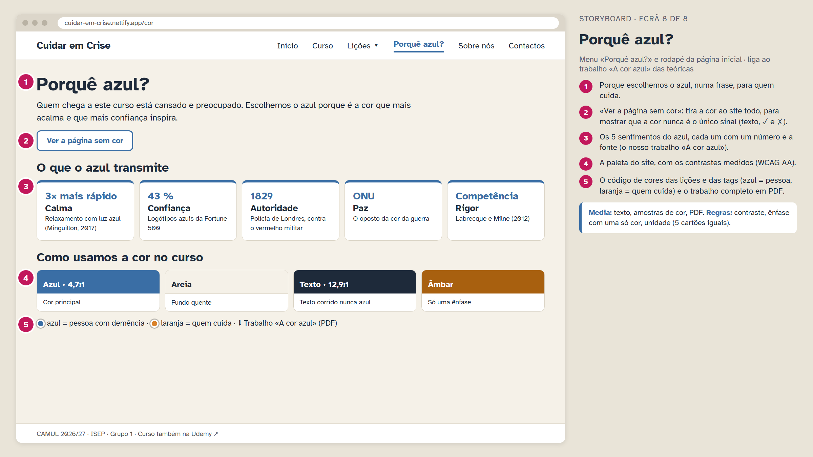

<!--
Scope document v2 (entregas 3, 4 e 5 de qua 18/11/2026): as 3 secções novas.
⚠ Os objetivos, o orçamento, os canais e o calendário do plano de marketing (secção 9) são propostas sem base em dados e o grupo acha os objetivos demasiado drásticos: perguntar à professora a 18/11 qual é o objetivo do plano (ver Plataforma_Plano.md, «Perguntar à professora»).
18/11: ecrã 8 «Porquê azul?» (sugestão da professora) acrescentado também no .docx, com a página na tabela da estrutura (secção 4) e no menu.
Este .md é a fonte do texto; o Plataforma_Scope_v2.ps1 insere-o no .docx antes de «Referências» (uma vez só, sobre a v1).
Depois disso o .docx edita-se no Word, como a v1. Se o texto mudar aqui, mudar também no Word.
Formato: «#» título numerado · «##» subtítulo · «- » ponto · «| … |» tabela (1.ª linha = cabeçalho) · «» imagem ·
«**Texto:**» no início de um parágrafo fica a negrito.
-->
# Cenário de qualidade (QEF)

Proposta do grupo para avaliar a plataforma, a validar pela professora (entrega 3). O cenário completo está no ficheiro `Plataforma_QEF_Grupo1.xlsx`, entregue com este documento: folha «QEF» (cálculo), uma folha por dimensão (indicador, níveis, instrumento e esforço de cada critério) e folha «Notas» (amostra, teste com utilizadores e registo da validação).

**Modelo:** QEF (Quality Evaluation Framework), como no exemplo da professora para a plataforma do portfólio. A qualidade organiza-se em dimensões, fatores e critérios. Cada critério tem um peso (10 fundamental · 8 muito importante · 6 importante · 4 necessário · 2 opcional) e um cumprimento medido numa escala de 5 níveis (0, 25, 50, 75 ou 100 %). Cada fator tem um peso dentro da sua dimensão (somam 1). A qualidade global é q = 1 − D/√3, em que D é a distância das 3 dimensões ao ponto ideal (100, 100, 100); q vai de 0 a 1.

**Dimensões:** Funcionalidade, Usabilidade e Estética, como pede o enunciado. A Eficiência e a Adaptabilidade do exemplo foram repartidas: desempenho, telemóvel e acessibilidade passam para a Usabilidade; composição, cor e letra para a Estética.

| Dimensão | Fator (peso) | Critérios | Exemplos |
|---|---|---|---|
| Funcionalidade | Navegação (0,20) | 3 | Menu fixo em todas as páginas; «anterior» e «seguinte» pela ordem do curso |
| Funcionalidade | Lições e avaliação (0,35) | 5 | Cada lição tem os blocos do modelo; o quiz funciona; feedback imediato que explica a resposta |
| Funcionalidade | Multimédia e Matterport (0,30) | 5 | A visita Matterport funciona dentro da página; as tags seguem o código de cores; os avatares tocam |
| Funcionalidade | Fiabilidade e privacidade (0,15) | 3 | Páginas sem erros; página 404 com caminho de volta; sem conta e sem dados pessoais |
| Usabilidade | Facilidade de uso (0,30) | 4 | Usa-se sem ajuda; SUS; qualquer lição a 2 cliques da página inicial |
| Usabilidade | Acessibilidade (0,40) | 7 | Só com o teclado; legendas e transcrição; zoom a 200 %; a cor não é o único sinal |
| Usabilidade | Telemóvel e desempenho (0,30) | 4 | Funciona em vários ecrãs; carrega depressa no telemóvel; página de lição leve com dados móveis |
| Estética | Composição visual (0,40) | 6 | Grelha e alinhamento; hierarquia; regra dos terços; espaço negativo; ênfase com uma só cor |
| Estética | Unidade e coerência (0,30) | 4 | As 5 lições com o mesmo modelo; paleta e letra respeitadas; coerente com o MOOC da Udemy |
| Estética | Legibilidade e qualidade dos media (0,30) | 4 | Contraste texto/fundo; botões identificáveis; vídeos com boa imagem e bom som |

Ao todo são 45 critérios: genéricos (G, valem para qualquer site educativo e vêm dos QEF de base) e específicos (E, desta plataforma: lições, Matterport, tags, avatares, modelo comum, regras da composição visual). Todos têm um indicador numérico (%, contagem, px, s, MB ou pontuação) e o instrumento para o medir (F12 do browser, Lighthouse, WAVE, teclado, cronómetro, SUS).

**Como se avalia:** a amostra são as 9 páginas (Início, Curso, Lição 1 a 5, Sobre nós, Contactos) e a página 404, no site publicado no Netlify, a 1280 px de largura e no telemóvel. No teste Alfa (antes de 25/11) cada critério é medido por quem não fez a página. Cinco critérios medem-se com utilizadores: pelo menos 5 pessoas fazem 4 tarefas sem ajuda (abrir a Lição 2, encontrar uma tag laranja na visita 3D, responder ao quiz, descarregar a checklist do kit), com cronómetro, e respondem ao SUS. Esforço de medição: 29 critérios fáceis, 11 moderados e 5 com utilizadores.

**Validação:** depois do parecer da professora, as alterações pedidas ficam registadas na folha «Notas» e o cenário validado é o que se usa na avaliação final (v3).

# Storyboard

O storyboard mostra os 8 ecrãs-chave da plataforma (entrega 4). Segue a estrutura do site da secção 4 e a página inicial da composição visual: paleta (areia, texto, azul, âmbar só no botão e nos números), letra Atkinson Hyperlegible, grelha de 12 colunas. Os conteúdos são os reais do MOOC (a L2 serve de exemplo para o modelo de lição, que é igual nas 5). Os números cor-de-rosa ligam cada zona do ecrã à nota ao lado; as notas dizem o conteúdo, a interação, a transição para o ecrã seguinte, os media e as regras de composição.

**Percurso típico:** link da campanha ou QR code → Início (1) → Curso (2) → Lição: vídeo (3) → visita 3D e atividade (4) → quiz com feedback (5) → lição seguinte. «Sobre nós» (6), «Porquê azul?» (8) e «Contactos» estão sempre no menu. O ecrã 7 mostra o mesmo percurso no telemóvel, que é o aparelho principal do público.

| Ecrã | Vem de | Leva a | Media |
|---|---|---|---|
| 1 · Início | Campanha, QR code, pesquisa | Curso; cada lição; Udemy | Ilustração, texto |
| 2 · Curso | Botão «Começar o curso», menu | Lição 1 a 5 | Texto, ícones |
| 3 · Lição: vídeo | Curso, menu «Lições» | Visita 3D, atividade, quiz; lição anterior e seguinte | Vídeo com câmara, legendas, transcrição |
| 4 · Lição: visita 3D e atividade | Índice da lição | Quiz | Matterport em iframe, texto, PDF |
| 5 · Quiz com feedback | Fim da lição | Lição seguinte | Texto, ícones ✓ ✗ |
| 6 · Sobre nós | Menu | Contactos, Udemy | Avatares D-ID (vídeo), texto |
| 7 · No telemóvel | — | O mesmo percurso, numa coluna | Os mesmos, carregados só ao toque |
| 8 · Porquê azul? | Menu, rodapé do Início | Curso; trabalho «A cor azul» (PDF) | Texto, amostras de cor, PDF |

# Plano de marketing

Plano para dar a conhecer a plataforma e o curso a quem cuida (entrega 5). Segue a estrutura dos planos de marketing da aula (projeto, recursos, ambiente, objetivos, marketing-mix, SWOT, ciclo de vida, ações, orçamento e calendário), adaptada a um produto gratuito e sem fins lucrativos: o objetivo não é vender, é chegar aos cuidadores e levá-los a fazer o curso.

## O projeto

**Conceito:** «Cuidar em Crise» é um curso curto (≈ 40 min), gratuito e em português, que aplica os primeiros socorros psicológicos à dupla cuidador e pessoa com demência numa crise (incêndio, cheia ou tempestade, pandemia, saída de casa por conflito). A plataforma web aloja o curso com a visita 3D interativa, que a Udemy não permite.

**Missão:** preparar quem cuida, em casa, de uma pessoa com demência para agir numa crise: acalmar, responder às necessidades imediatas, manter a rotina possível e saber quando pedir ajuda.

**Visão:** nenhum cuidador enfrenta uma crise sem saber o que fazer.

**Valores:** simplicidade (linguagem clara, aulas curtas) · acessibilidade (telemóvel, legendas, sem conta) · respeito (casa fictícia, sem dados pessoais, nunca uma pessoa com demência real) · rigor (fontes confirmadas, não substitui os profissionais).

**Mensagem:** «Quando a crise chega, saber o que fazer.»

## Recursos

- **Humanos:** 5 estudantes do ISEP; cada um é autor de uma lição e fala dela na divulgação.
- **Tecnológicos:** site em HTML, CSS e JavaScript no Netlify (grátis); curso publicado na Udemy (grátis); Matterport (plano grátis, 1 espaço ativo por conta); PowerPoint e D-ID para os vídeos; Google Forms para os inquéritos.
- **Financeiros:** sem orçamento próprio; tudo assenta em ferramentas grátis (ver «Orçamento»).

## Análise do meio envolvente

- **Político e legal:** o Estatuto do Cuidador Informal (Lei n.º 100/2019) reconhece estes cuidadores; há 18 149 com o Estatuto reconhecido (ISS, out. 2025). O curso respeita o RGPD: não pede conta nem guarda dados pessoais.
- **Social:** cerca de 182 500 pessoas com demência em Portugal (Alzheimer Portugal); 4.º lugar da OCDE em casos por 1000 habitantes e ≈ 322 000 casos previstos em 2037 (OCDE 2017). Dos cuidadores com Estatuto, 84 % são mulheres, com 57 anos em média, e 60,5 % dos avaliados estão em sobrecarga (ISS, out. 2025). Numa crise, o cuidador perde a sua rede de apoio (ADI, 2019).
- **Tecnológico:** o público usa sobretudo o telemóvel e tem literacia digital variável: por isso o site é leve, não pede conta e carrega os vídeos e a visita 3D só quando se toca.

## Público e concorrência

**Público principal:** cuidadores informais de pessoas com demência ligeira a moderada, em casa, em Portugal (sobretudo mulheres, ≈ 57 anos, pouco tempo, telemóvel). **Secundário:** familiares que querem estar preparados; voluntários e técnicos que apoiam cuidadores (associações, juntas de freguesia, IPSS).

**Persona:** a Ana, filha e cuidadora da D. Rosa. Trabalha, tem pouco tempo e vê vídeos no telemóvel ao fim do dia. Quer saber o que fazer se tiver de sair de casa com a mãe.

| | Cursos para cuidadores (ex.: iSupport, NAU, Santa Maria) | Cursos de primeiros socorros psicológicos | Cuidar em Crise |
|---|---|---|---|
| Duração | 14 h a 51 h | Variável | ≈ 40 min |
| Foco | O dia a dia | Geral, para todos | A crise: antes, durante, depois |
| Língua | Português | Sobretudo inglês | Português |
| Pessoa + cuidador | Só o cuidador | Não | A dupla, sempre |
| Prática em 3D | Não | Não | Visita à casa (Matterport) |

Os cursos para cuidadores são concorrência indireta e também parceiros: o nosso curso não os substitui, completa-os, e a L5 encaminha para eles.

## Objetivos

Até 31/12/2026 (primeiro mês depois do lançamento), medidos com as estatísticas do Netlify, o painel da Udemy e os inquéritos:
- 300 visitas ao site e 100 pessoas a abrir pelo menos uma lição;
- 50 inscrições no curso da Udemy;
- 5 associações ou entidades de apoio a cuidadores contactadas, e pelo menos 2 a divulgar o curso;
- SUS médio ≥ 68 nos testes Alfa e Beta (o mesmo valor de referência do QEF).

## Marketing-mix (7P)

- **Produto:** 5 lições de ≈ 8 min (vídeo com a cara do autor e legendas, visita Matterport com tags, atividade, quiz com feedback, recursos em PDF), em sequência temporal: compreender, antes, durante, depois.
- **Preço:** 0 €. Sem conta e sem dados pessoais no site; na Udemy basta a inscrição gratuita.
- **Distribuição (place):** o site no Netlify (aberto, no telemóvel e no computador) e o curso na Udemy (com o progresso guardado; nos cursos grátis a Udemy não dá certificado). Os dois ligam-se um ao outro.
- **Promoção:** publicações nas redes sociais com excertos de 30–60 s dos vídeos e da visita 3D; email a associações de cuidadores e de doentes de Alzheimer; folheto A5 com QR code para centros de saúde, farmácias e juntas de freguesia; apresentação nas aulas e na escola.
- **Pessoas:** os 5 autores aparecem nos vídeos (câmara) e nos avatares de «Sobre nós»; a D. Rosa e a Ana dão rosto às situações.
- **Processos:** do link ao curso em 2 cliques; feedback imediato nos quizzes; contacto por email para dúvidas e correções.
- **Evidência física:** identidade visual comum (paleta, letra, ilustrações), imagem do curso na Udemy e os PDFs para imprimir (checklist do kit, ficha da pessoa, plano de apoio, cartão de bolso).

## Análise SWOT

| | Positivo | Negativo |
|---|---|---|
| Interno | **Forças:** grátis, curto e em português; foco único na crise e na dupla; visita 3D interativa com tags; avatares e vídeos com a cara dos autores; já publicado na Udemy | **Fraquezas:** equipa de estudantes, sem profissionais de saúde; sem orçamento; L4 e L5 ainda sem legendas; plano grátis do Matterport limita os espaços |
| Externo | **Oportunidades:** crises cada vez mais frequentes (incêndios, cheias); Estatuto do Cuidador Informal; associações à procura de recursos para cuidadores; telemóvel em todo o lado | **Ameaças:** pouca literacia digital de parte do público; desconfiança de conteúdos online sobre saúde; o curso pode desatualizar-se; a Udemy ou o Matterport podem mudar as regras |

## Ciclo de vida

- **Introdução (25/11 → 31/12/2026):** lançamento do site, testes Alfa e Beta, primeiros contactos com associações. Prioridade: dar a conhecer.
- **Crescimento (2027):** divulgação pelas associações e pelos centros de saúde; correções a partir do feedback; legendas da L4 e da L5.
- **Maturidade:** o curso fica estável; revisão anual dos conteúdos e das ligações.
- **Sustentabilidade:** custos a 0 € (Netlify e Udemy grátis); código e conteúdos no repositório do grupo; se o espaço Matterport tiver de sair do plano grátis, a visita gravada no vídeo continua a funcionar.

## Plano de ações

| Ação | Canal | Para quem | Quando | Indicador |
|---|---|---|---|---|
| Lançar o site e ligar a Udemy ao site | Netlify, Udemy | Todos | 25/11 | Site no ar, sem erros (QEF) |
| 5 vídeos curtos (30–60 s), um por lição, com o autor | Instagram, Facebook, LinkedIn | Cuidadores, familiares | 25/11 → 15/12, 2 por semana | Visualizações, cliques no link |
| Email com o link e o folheto | Email | Associações de cuidadores e de Alzheimer, IPSS | 26/11 → 4/12 | Respostas, entidades que divulgam |
| Folheto A5 com QR code | Impresso | Centros de saúde, farmácias, juntas de freguesia | 1/12 → 15/12 | Visitas com origem no QR code |
| Apresentação na aula e na escola | Presencial | Colegas, docentes | 25/11 | Respostas ao inquérito Beta |
| Inquérito de satisfação (SUS) | Google Forms | Quem fez o curso | 25/11 → 31/12 | SUS médio, sugestões |

## Orçamento

| Rubrica | Custo |
|---|---|
| Alojamento do site (Netlify, plano grátis, endereço netlify.app) | 0 € |
| Curso na Udemy (curso grátis) | 0 € |
| Matterport (plano grátis, 1 espaço por conta) | 0 € |
| Redes sociais (publicações sem patrocínio) | 0 € |
| Folheto A5 com QR code, 50 exemplares (estimativa) | ≈ 10 € |
| Horas da equipa (trabalho académico) | 0 € |
| **Total** | **≈ 10 €** |

## Calendário

| Período | O quê |
|---|---|
| 18/11 → 24/11 | Preparar: vídeos curtos, folheto e QR code, lista de associações e contactos |
| 25/11 | Lançamento: site no ar, apresentação e teste Beta |
| 26/11 → 4/12 | Emails às associações; 2 publicações por semana |
| 1/12 → 15/12 | Folhetos nos centros de saúde, farmácias e juntas de freguesia |
| 16/12 → 31/12 | Medir os objetivos (Netlify, Udemy, inquérito) e ajustar a mensagem |
